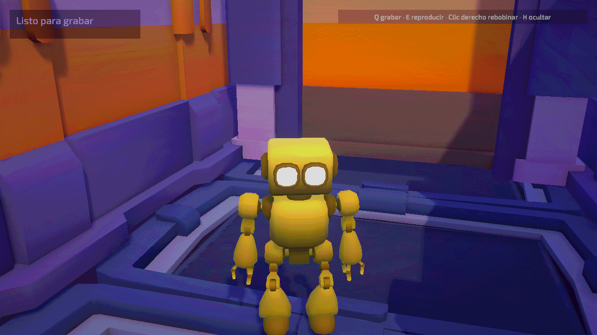
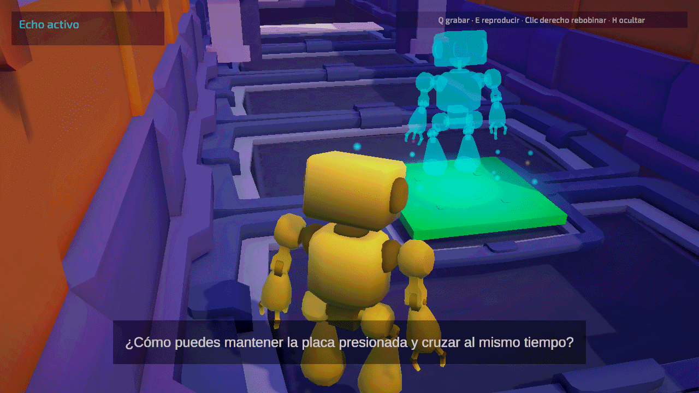
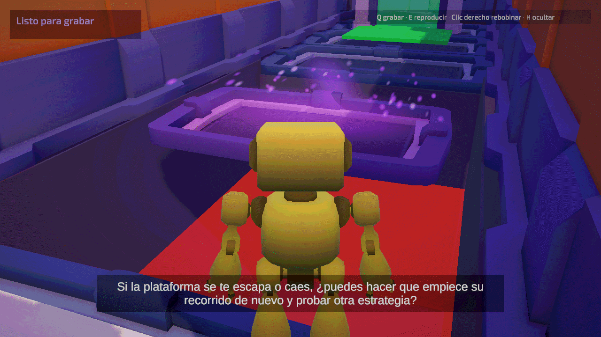
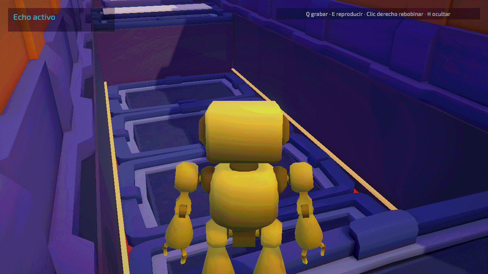
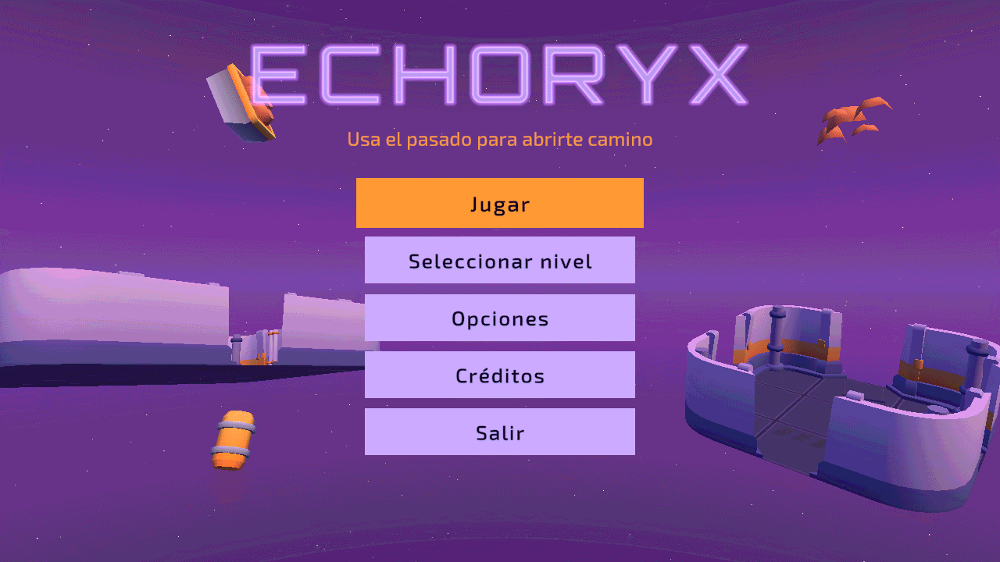
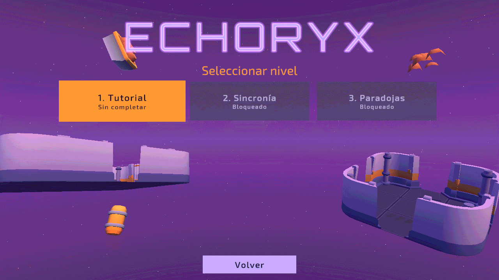

# Echoryx

**[Descargar el juego (Windows)](https://github.com/Raphinha1/Echoryx/releases/latest)**

[](https://unity.com/)
[](https://unity.com/srp/universal-render-pipeline)
[](docs/testing.md)
[]()

**Echoryx** es un videojuego 3D de plataformas y resolución de rompecabezas temporales desarrollado en **Unity 6** con **Universal Render Pipeline (URP)**. El jugador controla a un robot y utiliza dos habilidades temporales complementarias —la grabación y reproducción de acciones pasadas (**Echo**) y la reversión cinemática de objetos interactivos (**Rewind**)— para navegar salas modulares y superar obstáculos sincronizados.

---

## Documentación

- [Diseño: GDD v1.0](docs/GDD.md)
- [Technical Design Document (TDD)](docs/technical-design-document.md)
- [Historial de desarrollo](docs/historial-desarrollo.md)
- [Créditos y licencias](docs/credits.md)
- Niveles: [1, Tutorial](docs/level-01-tutorial.md) · [2, Sincronía](docs/level-02.md) · [3, Paradojas](docs/level-03.md)

### Cómo ejecutar

1. Abre el proyecto con Unity `6000.3.29f1`.
2. Importa *Animated Low Poly Robot Free* en `Assets/FreeLowPolyRobot/` (no está en Git).
3. Abre `Assets/_Echoryx/Scenes/MainMenu.unity` y pulsa Play. El repositorio no incluye un build.

**GPU híbrida en Linux:** hay que lanzarlo con estas variables, tanto para un build como para el Editor (sustituye la ruta del ejecutable):

```bash
__NV_PRIME_RENDER_OFFLOAD=1 __GLX_VENDOR_LIBRARY_NAME=nvidia <ruta-al-ejecutable>
```

### Controles

| Acción | Control |
|---|---|
| Moverse / cámara / saltar | WASD / ratón / Espacio |
| Echo: grabar o detener / reproducir | Q / E |
| Rewind | Mantener clic derecho apuntando al mecanismo |
| Volver al checkpoint / reiniciar nivel | R / Retroceso |
| Pausa / mostrar u ocultar ayuda | Esc (Start en mando) / H |

---

## Galería

| Nivel 1: el robot | Echo sobre una placa de presión |
|:---:|:---:|
|  |  |

| Rewind sobre una plataforma | Nivel 3: el puente que sube del foso |
|:---:|:---:|
|  |  |

| Menú principal | Selector de niveles |
|:---:|:---:|
|  |  |

---

## Requisitos y Apertura

- **Unity Editor:** `6000.3.29f1` (consistente con `ProjectSettings/ProjectVersion.txt`).
- **Apertura:** Abrir la raíz del proyecto desde **Unity Hub**. Unity Package Manager resolverá automáticamente las dependencias declaradas en `Packages/manifest.json`.
- **Paquetes Principales Integrados:**
  - Universal Render Pipeline (`com.unity.render-pipelines.universal` @ `17.3.0`)
  - Input System (`com.unity.inputsystem` @ `1.20.1`)
  - Cinemachine (`com.unity.cinemachine` @ `3.1.7`)
  - Test Framework (`com.unity.test-framework` @ `1.6.0`)
- **Robot (se importa aparte):** el paquete *Animated Low Poly Robot Free* (Unity Asset Store, de Juanpmh) **no está en Git** por la EULA del Asset Store. Antes de jugar o ejecutar pruebas, impórtalo desde el Package Manager en `Assets/FreeLowPolyRobot/`; sin él faltan el modelo y las animaciones del Player y del Echo.

---

## Controles del Videojuego

| Acción | Tecla / Control | Descripción |
|---|---|---|
| **Moverse** | `W` `A` `S` `D` | Movimiento planar relativo a la orientación de la cámara |
| **Orbitar Cámara** | `Ratón` | Rotación orbital en tercera persona con Cinemachine |
| **Saltar** | `Espacio` | Salto vertical con *Coyote Time* y *Jump Buffering* |
| **Grabar Echo** | `Q` | Graba hasta 5 segundos de acciones (posición y rotación a 20 Hz) |
| **Reproducir Echo** | `E` | Instancia un clon holográfico que replica la trayectoria grabada |
| **Rebobinar (Rewind)** | `Click Derecho (RMB)` *(mantener)* | Rebobina en el tiempo el mecanismo o plataforma apuntada |
| **Reiniciar Sala** | `R` | Devuelve al jugador al checkpoint activo y reinicia los mecanismos de la sala |
| **Pausa** | `Esc` (mando: Start) | Menú con Reanudar, Reintentar nivel y Menú principal |
| **Reiniciar Nivel** | `Retroceso` | Reinicia el nivel desde cero |
| **Ayuda en pantalla** | `H` | Muestra u oculta el recordatorio de controles |

---

## Mecánicas Principales

### 1. Grabación y Clon Temporal (Echo)
Al presionar `Q`, el sistema comienza a registrar las poses y rotaciones del jugador durante un máximo de 5 segundos. Al pulsar `E`, un actor holográfico cian reproduce el recorrido exacto. Esta mecánica permite resolver retos asíncronos (por ejemplo, pararse sobre una placa de presión que abre una compuerta distante, grabar el tiempo necesario, correr hacia la puerta y ejecutar el clon para que mantenga la placa activada).

### 2. Reversión Cinemática de Objetos (Rewind)
El jugador puede apuntar con el ratón hacia objetos móviles (como plataformas flotantes) y mantener presionado `RMB`. El objeto retrocede fotograma a fotograma por su trayectoria histórica. Al soltar `RMB`, el mecanismo reanuda su movimiento normal hacia adelante desde el punto temporal recuperado, permitiendo cruzar abismos o recuperar plataformas que ya habían partido.

### 3. Checkpoints y Restauración Determinista de Salas
El juego divide los desafíos en salas independientes. Si el jugador cae al abismo o pulsa `R`, el sistema restaura el estado exacto de la sala en curso (posiciones iniciales de plataformas, compuertas y placas, y elimina el clon activo; la última grabación terminada se conserva), garantizando que los puzles no queden en estados irrecuperables.

---

## Pipeline Visual y Animación

- **Entorno Sci-Fi Modular:** Piezas CC0 de Kenney (Modular Space Kit y Space Station Kit) con materiales URP propios; ver [créditos](docs/credits.md).
- **Protagonista:** Robot animado (paquete *Animated Low Poly Robot Free*, rig Generic); ver [créditos](docs/credits.md).
- **Locomoción y Física Desacopladas:** [`PlayerMotor`](Assets/_Echoryx/Scripts/Player/PlayerMotor.cs) mantiene la autoridad absoluta del movimiento físico, mientras que [`RobotAnimationDriver`](Assets/_Echoryx/Scripts/Player/RobotAnimationDriver.cs) y [`ResolvedPlanarMotion`](Assets/_Echoryx/Scripts/Player/ResolvedPlanarMotion.cs) calculan la cadencia y transiciones del Animator aislando el transporte de plataformas móviles, evitando que el personaje camine en falso cuando la plataforma lo transporta.

---

## Catálogo de Escenas

Las escenas principales se encuentran en `Assets/_Echoryx/Scenes/`:

- **`MainMenu.unity`:** Primera escena del build: Jugar, Seleccionar nivel y Salir ([flujo del juego](docs/game-flow.md)).
- **`Level_01_Tutorial.unity`:** Nivel tutorial de tres salas que enseña Echo y Rewind ([detalle](docs/level-01-tutorial.md)).
- **`Level_02_Sincronia.unity`:** Segundo nivel: tres salas que combinan Echo y Rewind ([solución](docs/level-02.md)).
- **`Level_03_Paradojas.unity`:** Tercer nivel, «Laboratorio de Paradojas»: cinco tramos que combinan Echo y Rewind, con un acertijo final en dos etapas ([solución](docs/level-03.md)).
- **`RobotIntegrationLab.unity`:** Laboratorio del robot; lo usan las pruebas PlayMode de locomoción.

---

## Pruebas y Calidad de Software

El proyecto se rige por Desarrollo Guiado por Pruebas (TDD) y cuenta con una batería completa de pruebas automatizadas ejecutables en Unity Editor y batchmode:

```bash
# Ejecutar pruebas EditMode desde terminal:
/ruta/hacia/Unity -batchmode -quit -projectPath . -runTests -testPlatform editmode -testResults editmode-results.xml

# Ejecutar pruebas PlayMode desde terminal:
/ruta/hacia/Unity -batchmode -quit -projectPath . -runTests -testPlatform playmode -testResults playmode-results.xml
```

- **EditMode:** 131 pruebas
- **PlayMode:** 64 pruebas
- **Total:** **195 pruebas automatizadas** (conteo del código; ver el [TDD, sección 5](docs/technical-design-document.md#5-estrategia-de-pruebas-y-tdd))

Para más detalles, consulta la [documentación de pruebas](docs/testing.md).

---

## Documentación del Proyecto

- 🎮 [Game Design Document (GDD)](docs/GDD.md)
- 🧩 [Nivel 1: Tutorial](docs/level-01-tutorial.md)
- 🧩 [Nivel 2: Sincronía](docs/level-02.md)
- 🧩 [Nivel 3: Paradojas](docs/level-03.md)
- 🧭 [Flujo del juego: menú, niveles, pausa y progreso](docs/game-flow.md)
- ✨ [Efectos visuales](docs/vfx.md)
- 🔊 [Audio: mixer, librería de sonidos y dónde asignar clips](docs/audio.md)
- 🏛️ [Arquitectura de Software y Ensamblados](docs/architecture.md)
- 📅 [Plan de Desarrollo y Roadmap](docs/development-plan.md)
- 🧪 [Guía de Pruebas y Validación](docs/testing.md)
