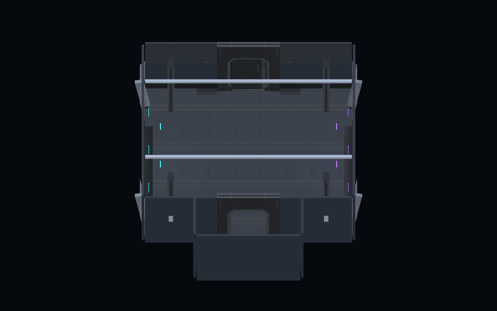
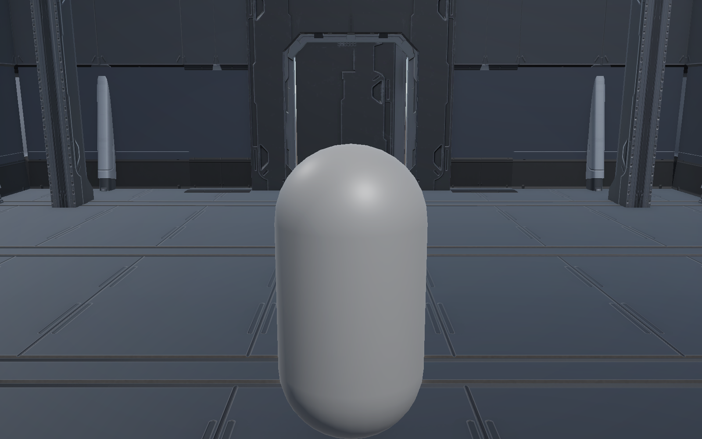
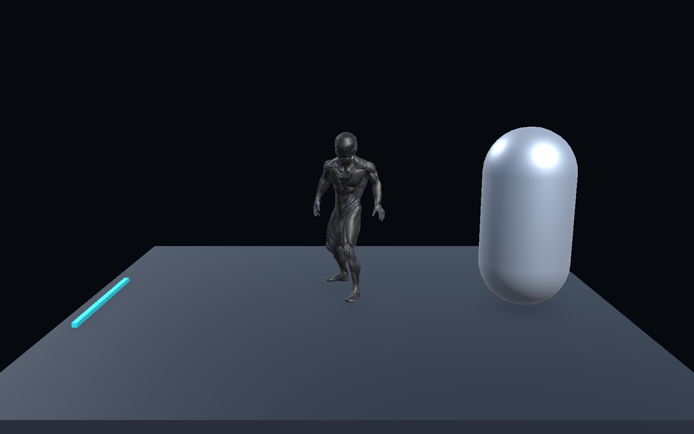
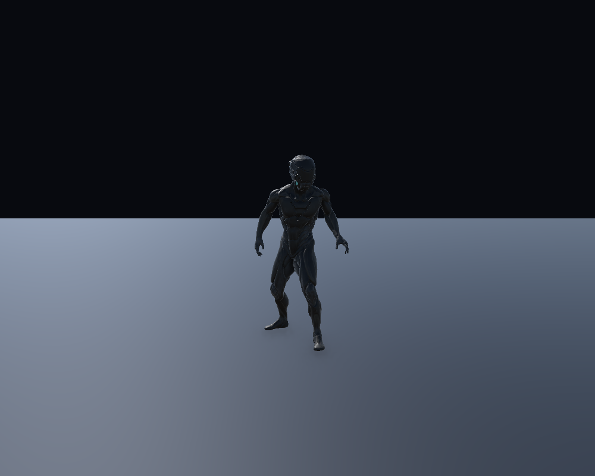
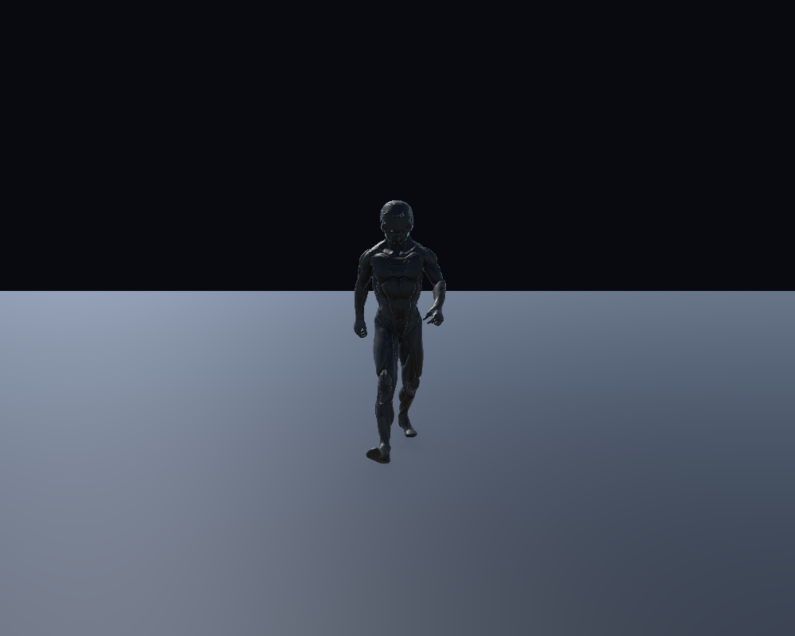
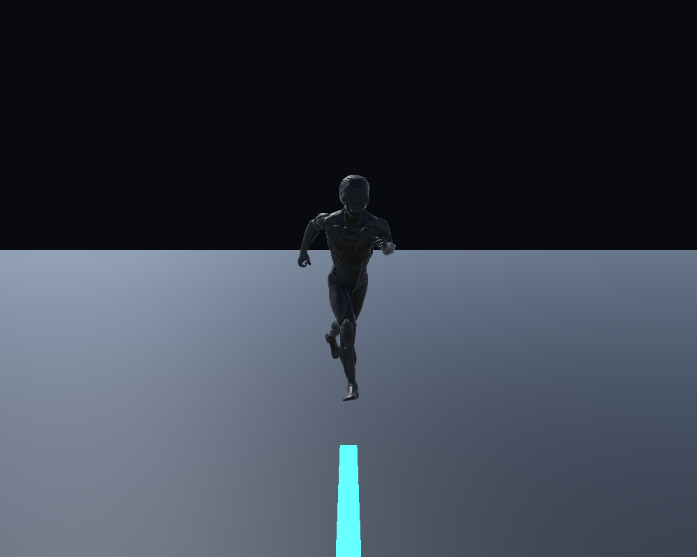
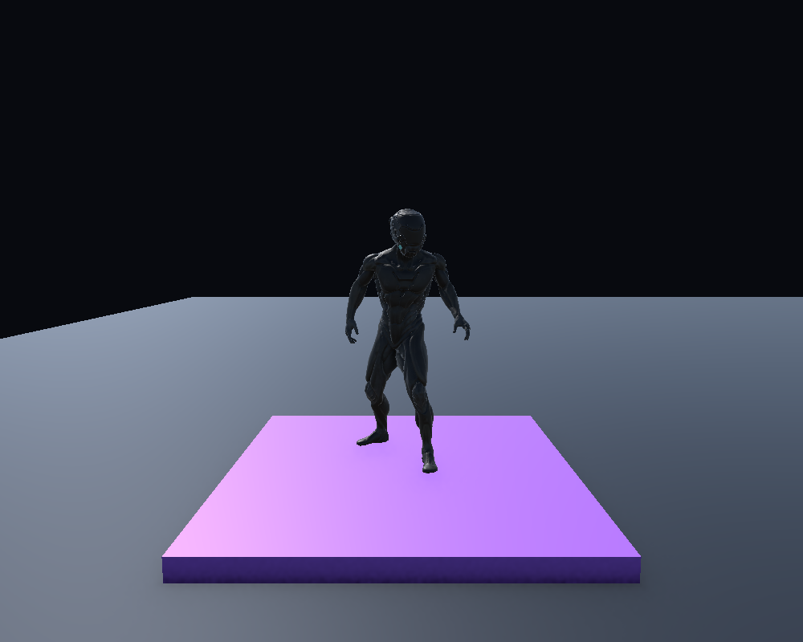
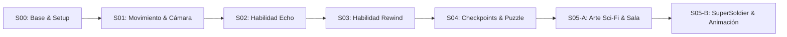

# Echoryx — Informe General de Avance del Proyecto

**Proyecto:** Echoryx  
**Materia:** Desarrollo de Entretenimiento (ISC 7.° Semestre)  
**Motor y Pipeline:** Unity 6 (`6000.3.22f1`) con Universal Render Pipeline (URP 17.3.0)  
**Repositorio GitHub:** [https://github.com/Raphinha1/Echoryx](https://github.com/Raphinha1/Echoryx)  
**Fecha de corte:** Octubre 2026  

---

## 1. Resumen Ejecutivo

**Echoryx** es un videojuego 3D de plataformas y resolución de rompecabezas temporales en tercera persona desarrollado en Unity 6. El jugador controla a un soldado con armadura tecnológica (*SuperSoldier*) y utiliza dos habilidades temporales complementarias —el registro y reproducción de acciones pasadas (**Echo**) y la reversión cinemática de objetos interactivos (**Rewind**)— para navegar salas modulares y superar obstáculos sincronizados.

Hasta el momento, el proyecto ha completado todas las etapas de diseño técnico, arquitectura de software, validación de mecánicas núcleo, desarrollo de niveles de prueba (*labs*), integración del pipeline visual sci-fi y acoplamiento de animación humanoide con el motor de físicas, respaldado por una suite de **116 pruebas automatizadas** (91 EditMode y 25 PlayMode) con tasa de éxito del 100%.

---

## 2. Ficha Técnica y Dependencias

| Parámetro | Especificación |
|---|---|
| **Unity Editor** | `6000.3.22f1` |
| **Render Pipeline** | Universal Render Pipeline (URP `17.3.0`) |
| **Input System** | Unity Input System (`1.20.1`) con mapeo unificado de acciones |
| **Cámara** | Cinemachine (`3.1.7`) con control orbital y amortiguación de colisiones |
| **Arquitectura de Código** | Ensamblados modulares (`Echoryx.Player`, `Echoryx.Echo`, `Echoryx.Rewind`, `Echoryx.Rooms`, `Echoryx.Game`) con desacoplamiento estricto |
| **Cobertura de Pruebas** | 91 pruebas EditMode y 25 pruebas PlayMode automatizadas |

---

## 3. Demostración Visual y Capturas del Proyecto

### 3.1. Pipeline Visual y Sala de Referencia (S05-A)

Se definió una dirección de arte de ciencia ficción industrial con paleta grafito/titanio y señalética emisiva (cian para Echo, violeta para Rewind). La sala de referencia visual (`VisualReferenceRoom.unity`) integra piezas de entorno modulares (plataformas, muros, columnas, pasarelas y puertas estructurales) con colliders convexos y materiales URP optimizados.

*Figura 1: Vista general de la sala de referencia visual con arquitectura modular, contraste lumínico y materiales URP.*

*Figura 2: Cámara Cinemachine en tercera persona orbitando sobre el entorno de prueba.*

---

### 3.2. Protagonista Humanoid: SCI-FI SuperSoldier (S05-B)

Tras evaluar candidatos y descartar mallas sin rig, se integró el modelo **SCI-FI SuperSoldier** (SihaGames & Udon-San, CC BY 4.0). Cuenta con un rig Humanoid completo de 66 huesos, escalado al factor correcto y configurado con IK en pies para evitar penetraciones de calzado.

*Figura 3: Rig Humanoid del SuperSoldier validado en el laboratorio visual.*

---

### 3.3. Locomoción y Ciclos de Animación (S05-B3 y S05-B4)

Se diseñó un *Blend Tree* de locomoción calibrado a la velocidad real del motor (`PlayerMotor`), con transiciones fluidas de reposo (*Idle*), caminata (*Walk*), carrera (*Run*), preparación de salto (*Jump*), caída (*Fall*) y aterrizaje (*Land*).

| Reposo (Idle) | Caminata (Walk) |
|:---:|:---:|
|  |  |
| *Figura 4: Pose de reposo (IdleLoop) con respiración y peso centrado.* | *Figura 5: Ciclo de caminata con contacto firme en talón y punta.* |

| Carrera (Run) | Sobre Plataforma Móvil |
|:---:|:---:|
|  |  |
| *Figura 6: Ciclo de carrera a cadencia sincronizada con el motor.* | *Figura 7: Desacoplamiento de velocidad sobre plataforma móvil en movimiento.* |

---

## 4. Cronología de Hitos y Entregables Completados

### S00 — Inicialización y Cimientos de Arquitectura
- Configuración de Unity 6 (`6000.3.22f1`) con Universal Render Pipeline.
- Estructura limpia de proyecto (`Assets/_Echoryx/Scripts`, `Scenes`, `Prefabs`, `Art`, `Tests`).
- Configuración de ensamblados Assembly Definition (`.asmdef`) para aislar dominio, infraestructura y tests.

### S01 — Controlador del Jugador en Tercera Persona
- Implementación de [`PlayerMotor`](../../Assets/_Echoryx/Scripts/Player/PlayerMotor.cs) basado en `CharacterController`.
- Física terrestre y aérea: aceleración suave, deceleración responsiva, gravedad configurable.
- Tolerancias de plataformeo clásicas: **Coyote Time** (salto unos fotogramas tras dejar un borde) y **Jump Buffering** (registro anticipado del salto antes de tocar tierra).
- Cámara en tercera persona con `CinemachineBrain` y seguimiento orbital amortiguado que impide clipping con geometrías.

### S02 — Mecánica Temporal "Echo" (Q / E)
- **Grabación (Q):** Al pulsar `Q`, el sistema registra un historial de hasta 5 segundos a 20 Hz con marcas temporales, posición y rotación del jugador.
- **Reproducción (E):** Al pulsar `E`, se instancia un clon holográfico translúcido cian que reproduce exactamente la trayectoria grabada sin bloquear físicamente al jugador original.
- **Interacción con Entorno:** Placas de presión que abren compuertas mientras se mantenga peso sobre ellas. El jugador puede grabar su posición en la placa, correr hacia la puerta y ejecutar el clon para que este sostenga la placa activa mientras cruza.

### S03 — Mecánica Temporal "Rewind" (Click Derecho / RMB)
- **Historial de Entidades:** Componentes desacoplados que guardan una ventana deslizante de estados para objetos interactivos (plataformas móviles, rotores).
- **Control Cinemático Dirigido:** Al apuntar hacia una plataforma y mantener `RMB`, el objeto retrocede en el tiempo por su trayectoria recorrida.
- **Inercia y Continuidad:** Al soltar `RMB`, el objeto reanuda su movimiento natural hacia adelante desde la posición recuperada, permitiendo al jugador alcanzar plataformas que ya habían partido.

### S04 — Checkpoints, Reaparición y Sala Combinada
- **Checkpoints y Reset (R o Caída):** Sistema de salas con límites definidos. Si el jugador cae al vacío o presiona `R`, reaparece en el último checkpoint activo.
- **Restauración Determinista:** El reinicio no solo reposiciona al jugador, sino que resetea las placas, compuertas y plataformas de la sala en curso, cancelando cualquier clon o grabación activa sin romper el estado global del juego.
- **Sala Combinada (`S04-C Combined Puzzle`):** Rompecabezas que exige la ejecución coordinada de ambas mecánicas:
  1. Usar **Echo** para mantener abierta una compuerta pesada y cruzar hacia una zona intermedia segura.
  2. Usar **Rewind** desde dicha zona para recuperar una plataforma móvil que ya partió, montarse en ella y cruzar hacia el muelle de llegada.

### S05 — Pipeline Visual y Locomoción Humanoide
- **S05-A1 / S05-A2:** Creación de biblioteca de piezas sci-fi modulares Quaternius (CC0) y construcción de la sala de referencia visual (`VisualReferenceRoom.unity`).
- **S05-B1 / S05-B2:** Evaluación, selección y validación técnica del modelo *SuperSoldier*, verificando escala (1.85 m), proporciones y compatibilidad de huesos.
- **S05-B3:** Calibración de animaciones Mixamo (Walk, Run, Jump, Fall, Land, Idle) corrigiendo offsets de pies, orientación de pelvis y evitando deslizamientos (*foot sliding*).
- **S05-B4:** Integración entre el motor físico (`PlayerMotor`) y la animación visual (`PlayerAnimationDriver` y `ResolvedPlanarMotion`). El movimiento del jugador maneja su propia velocidad independientemente del transporte de plataformas móviles, logrando que el personaje no "corra en el lugar" cuando es transportado pasivamente por una plataforma.

---

## 5. Tabla de Controles del Videojuego

| Acción | Entrada (Teclado / Ratón) | Comportamiento |
|---|---|---|
| **Moverse** | `W` / `A` / `S` / `D` | Desplazamiento relativo a la orientación de la cámara |
| **Orbitar Cámara** | Ratón | Rotación orbital de la cámara en tercera persona |
| **Saltar** | `Espacio` | Salto vertical con *Coyote Time* y *Jump Buffer* |
| **Grabar Echo** | `Q` | Inicia o detiene la grabación temporal (máximo 5 segundos) |
| **Reproducir Echo** | `E` | Invoca al clon holográfico para reproducir las acciones grabadas |
| **Rebobinar (Rewind)** | `Click Derecho (RMB)` (mantener) | Rebobina el mecanismo u objeto apuntado a través de su historial |
| **Reiniciar / Reaparecer** | `R` | Devuelve al jugador al checkpoint de la sala activa y restaura sus mecanismos |

---

## 6. Arquitectura de Software y Principios de Diseño

El proyecto fue construido bajo estrictos principios de arquitectura limpia y desarrollo guiado por pruebas:

1. **Desacoplamiento Física vs. Presentación:**
   [`PlayerMotor`](../../Assets/_Echoryx/Scripts/Player/PlayerMotor.cs) es la única autoridad de desplazamiento mediante `CharacterController`. La presentación visual (`PlayerAnimationDriver` (retirado; en el historial de Git)) se ejecuta en `DefaultExecutionOrder(20)`, leyendo la velocidad resuelta en el fotograma actual sin aplicar jamás Root Motion físico.
2. **Medición Aislada de Movimiento Planar:**
   La clase estática [`ResolvedPlanarMotion`](../../Assets/_Echoryx/Scripts/Player/ResolvedPlanarMotion.cs) filtra el desplazamiento aportado por plataformas móviles o colisiones oblicuas contra muros, garantizando que el `Animator` solo responda al movimiento voluntario del jugador.
3. **Aislamiento por Salas (*Room Scoping*):**
   Los puzzles están aislados en componentes de sala. Los checkpoints pertenecen a una sala específica; al disparar un reinicio, únicamente los suscriptores de esa sala son reseteados a su pose y estado inicial.
4. **Almacenamiento Circular de Historial:**
   Los componentes de *Rewind* emplean estructuras de anillo temporal con interpolación determinista basada en `Time.fixedDeltaTime`, evitando consumo desmedido de memoria.

---

## 7. Verificación y Resultados de Pruebas

Toda la base de código cuenta con verificación automatizada ejecutada en Unity batchmode:

| Plataforma de Pruebas | Casos Ejecutados | Casos Exitosos | Fallos | Estado |
|---|:---:|:---:|:---:|:---:|
| **EditMode Tests** | 91 | 91 | 0 | **PASADO (100%)** |
| **PlayMode Tests** | 25 | 25 | 0 | **PASADO (100%)** |
| **Total Combinado** | **116** | **116** | **0** | **VERIFICADO** |

Las pruebas cubren desde la interpolación matemática de cuaterniones y tiempos de muestreo hasta flujos completos de interacción de juego (puzle de Echo, cruce de plataforma en Rewind, persistencia de salas combinadas y pruebas de retargeting de animación).

---

## 8. Catálogo de Escenas del Proyecto

Las escenas están organizadas en `Assets/_Echoryx/Scenes/`:

- **`Prototype.unity`**: Escena integral de juego donde se encuentran el circuito de pruebas de movimiento, el puzzle de Echo (placa y puerta), el puzzle de Rewind (plataforma móvil sobre el abismo) y la sala combinada S04-C.
- **`VisualReferenceRoom.unity`**: Sala de pruebas visuales con la estética definitiva sci-fi, iluminación URP, prefabs modulares y cámara orbital.
- **`PlayerAnimationIntegrationLab.unity`**: Laboratorio de pruebas de locomoción del SuperSoldier sincronizado con las físicas reales de `PlayerMotor` y plataformas móviles.
- **`SuperSoldierLocomotionLab.unity`**: Laboratorio aislado de animación para inspección y calibración fotograma a fotograma de clips de Mixamo.
- **`VisualAssetLab.unity`**: Galería de inspección de piezas 3D modulares y materiales URP.

---

## 9. Próximos Pasos (Roadmap)

Con las mecánicas base, la arquitectura y el pipeline visual completamente probados y consolidados, el plan de trabajo para las siguientes entregas contempla:

1. **Sustitución en Escena Principal:** Migrar el modelo *SuperSoldierVisual* como representación oficial del jugador en `Prototype.unity` y niveles de juego.
2. **Diseño de Niveles Definitivos:** Construir los tres niveles cortos temáticos y el nivel de desafío final aplicando las piezas modulares sci-fi de la sala de referencia.
3. **Interfaz de Usuario (HUD):** Diseñar e implementar el HUD mínimo (indicador de grabación Echo, selector de objetivo Rewind e indicador de checkpoint).
4. **Audio y Efectos Visuales (VFX):** Incorporar efectos de partículas en URP (holograma de Echo, distorsión temporal en Rewind) y diseño de sonido diegético.
