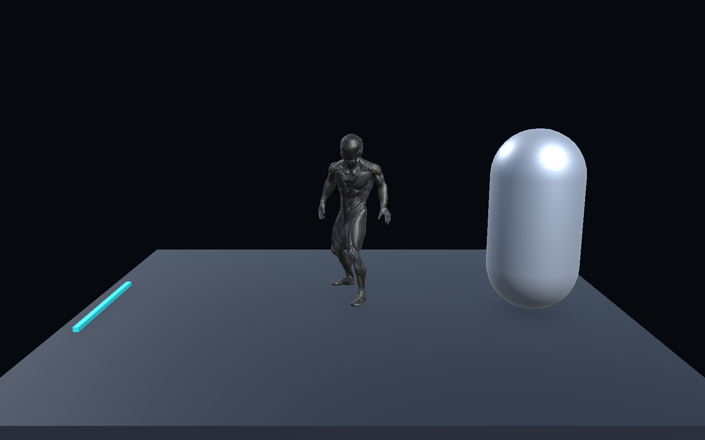

# S05-B2 — validación del protagonista SCI-FI SuperSoldier

## Decisión y estado

**S05-B2 aprobado técnica y visualmente.** El modelo es apto como base de protagonista animado, sin rigging manual. Unity genera un Avatar Humanoid válido desde el FBX; locomoción completa se validó en S05-B3. Sigue sin reemplazar Player; la integración visual con PlayerMotor corresponde al S05-B4 pendiente.

## Fuente, integridad y licencia

- Candidato: [SCI-FI SuperSoldier — Game-ready Animated](https://sketchfab.com/3d-models/sci-fi-supersoldier-game-ready-animated-09e0bd9c9715463584cd847d9b30a140), **SihaGames**, Sketchfab.
- ZIP en `~/Descargas/sci-fi-supersoldier-game-ready-animated.zip`, 85,066,290 bytes, SHA-256 `6bc8cad1319875f6fde596acc30cae01661eff7774d08d3e128d27fda7f57e5b`.
- El modelo está publicado bajo [CC BY 4.0](https://creativecommons.org/licenses/by/4.0/): atribuir a SihaGames, enlazar la obra y licencia, identificar adaptaciones y no sugerir respaldo.
- La descripción del autor acredita el casco a **Udon-San** y dice que fue retexturizado. El [modelo del casco](https://sketchfab.com/3d-models/sci-fi-helmet-785f5cfd848940b1a4a0b8ddeefc9ef1) también publica CC BY 4.0; se conserva crédito separado.
- El flujo de creación de la animación menciona Mixamo. La FAQ y las condiciones de [Adobe Mixamo](https://helpx.adobe.com/ie/creative-cloud/faq/mixamo-faq.html) permiten usar personajes/animaciones en proyectos y juegos, pero limitan redistribuir sus recursos como archivos independientes; integrar el personaje en el juego es el uso previsto. No se extrajo ni se descargó ningún asset de Mixamo aparte del FBX entregado.
- El ZIP contiene exactamente un FBX y cuatro PNG. No incluye un archivo de licencia ni más aviso de créditos. ATTRIBUTION.md (retirado; en el historial de Git) y provenance.json (retirado; en el historial de Git) guardan créditos, enlaces, licencias y SHA-256 por original. Los cinco ficheros importados coinciden byte por byte con el ZIP; no se modificaron los originales. El JSON conserva metadatos resumidos y no copia descripciones extensas.

## Inspección e importación aislada

Se importó únicamente después de confirmar huesos y skinning. Ubicación:

```text
Art/Characters/SihaGamesSuperSoldier/
  Idle.fbx
  Textures/{file2,file4,file8,file10}.png
  SuperSoldierPreview.controller
  ATTRIBUTION.md
  provenance.json
Materials/Characters/SihaGamesSuperSoldier/*.mat
Scenes/SuperSoldierValidationLab.unity
```

El FBX contiene 25 mallas vinculadas a **25 SkinnedMeshRenderer**, 57 nodos de hueso Mixamo en la fuente (46 referenciados por renderers en Unity) y 87 bind poses. Humanoid `Create From This Model` produce un Avatar `IdleAvatar` con `isValid=true`, `isHuman=true`; no hubo que mapear ni crear rig manualmente. Importación a altura aproximada de 2 m; el bounds original de Unity mide 1.463 × 2.027 × 1.463 m.

| Métrica | Resultado |
|---|---:|
| Triángulos (Unity, suma de submeshes) | 66,982 |
| Vértices en mallas importadas | 37,333 |
| SkinnedMeshRenderer / mallas | 25 / 25 |
| Huesos referenciados / bind poses | 46 / 87 |
| Materiales distintos / slots en el personaje | 7 / 27 |
| Texturas | 4 PNG, fuente 4096² → importación 2048² con mipmaps |
| Clips | 1, `mixamo.com`, 1.967 s, 30 fps |

El conteo Sketchfab de 66,982 faces coincide con la suma de triángulos de Unity. El conteo de vértices de Unity suma mallas separadas y puede diferir del vértice total de la página.

Los siete materiales se remapearon a URP Lit. `file2`/`file8` son BaseColor, sRGB; `file4`/`file10` son normales, importadas como NormalMap lineal. Compresión observada en Linux: DXT1 para color y DXT5 para normal. No se usaron shaders Standard ni recursos externos. El informe serializado con valores de Unity está en [supersoldier-import-report.json](supersoldier-import-report.json).

## Animación y costo

En la etapa B2 se reprodujo el clip Idle `mixamo.com` mediante un Animator Controller de vista previa; en ese momento no estaban importados Walk, Run, Jump, Fall o Land. La etapa B3 añadió y validó ese conjunto. Para dos instancias iguales, el límite geométrico aproximado sería **133,964 triángulos**, 50 renderer-partes y 54 slots, reutilizando los mismos siete materiales. Esto no mide FPS ni draw calls finales; las sombras y la plataforma pueden aumentar el costo. La escena no incluye luces de gameplay, CharacterController ni sistemas Echo.

La captura URP del laboratorio se conserva en `docs/images/s05-b2-supersoldier.png`. El personaje se presenta de frente con ajuste de orientación en la instancia de laboratorio; el FBX, su rig y sus ejes permanecen intactos. La referencia cápsula de 2 m ayudó a comparar proporciones; el usuario aprobó después el aspecto y la locomoción en los laboratorios B2/B3. PlayerMotor y la vista dentro del gameplay siguen fuera de esas aprobaciones.



## Validación de B2 y alcance posterior

Unity 6000.3.22f1 compiló el importador de Editor y completó la importación/validación. La prueba PlayMode aislada verifica Avatar Humanoid, Animator Controller, avance temporal del clip y SkinnedMeshRenderers. La escena `SuperSoldierValidationLab` es independiente y no está en Build Settings. Durante B2 no se tocó `Player`, Prototype, Laboratory, Echo, Rewind, Checkpoints ni VisualReferenceRoom. El checkout ya tenía cambios S05 sin confirmar; fueron preservados. No hay commit.

El usuario confirmó la revisión técnica y visual de B2/B3. Las pruebas de laboratorio no validan sincronización con PlayerMotor, adaptación de cápsula, clon simultáneo, rendimiento del build ni distribución; son asuntos posteriores, con integración visual en S05-B4.

### Siguiente etapa

S05-B3 completó y recibió aprobación manual para Idle/Walk/Run/Jump/Fall/Land y sus transiciones. S05-B4 queda pendiente para integrar el hijo visual con PlayerMotor conservando CharacterController, cámara y autoridad de movimiento.
