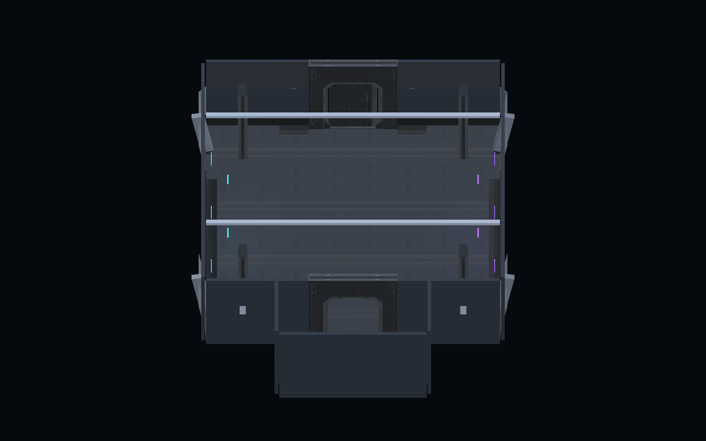
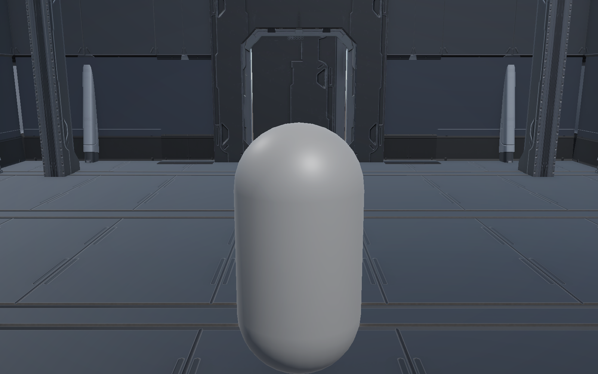

# S05-A2 — Sala de referencia visual

## Entrega y límites

**Estado:** S05-A2 fue aprobado técnica y manualmente por el usuario. La limpieza posterior eliminó el objeto de prueba FPS; el delta local de cámara/serialización de luces se conserva para revisión, sin atribuirle una intención no confirmada.

`Assets/_Echoryx/Scenes/VisualReferenceRoom.unity` es una sala aislada para validar la biblioteca gratuita [S05-A1](visual-assets.md), escala, iluminación, colisiones y cámara. No es el nivel definitivo ni un rompecabezas. No se añadieron materiales, shaders, paquetes, Rigidbody ni componentes de gameplay nuevos. El montaje usa componentes estándar y el Player/rig existentes; las herramientas nuevas son solo de Editor y pruebas.

Se comenzó con Git limpio en `039cc89` (`feat: add sci-fi environment assets and URP materials`). No se modifican Prototype, Laboratory, VisualAssetLab, fuentes FBX/PNG, materiales, prefab Player, sistemas ni tests anteriores. Los nuevos `.prefab` y `.unity` se guardaron mediante APIs de Unity; sus `.meta` son del Editor.

## Prefabs reutilizables

En `Assets/_Echoryx/Prefabs/Environment/`, raíces a escala (1,1,1), rotación identidad y pivote lógico sobre suelo:

| Prefab | Raíz y mallas | Colisión independiente |
|---|---|---|
| `Floor4` | Centro de baldosa en su cara superior, y=0. FBX de 4×4 m y respaldo grafito de 0,30 m de espesor. | BoxCollider de 4×0,30×4 m, bajo la superficie; no depende del plano sin grosor. |
| `Wall4` | Centro inferior, cara interior hacia +Z. Pared inferior, remates superior/inferior y respaldo opaco. Compensa el pivote nativo x=2 con rotación/offset del hijo. | BoxCollider de 4×5×0,30 m, separado de Visuals. |
| `InnerCorner4` | Intersección de planos al suelo; brazos de 4 m hacia -X y +Z. Compensa el encuentro nativo (4,0,-4), preservando el FBX. Dos remates superiores cierran la altura de 5 m. | Dos BoxCollider conservadores para brazos/ornamentos; no un bloque que ocupe el interior vacío. |
| `Column5` | Centro inferior, corrige offset Z del hijo. Columna de unos 5 m. | BoxCollider de 0,51×5×0,98 m. |
| `DoorFramePanel` | Centro del umbral. `Frame` y `Panel` separados. Estado por defecto: panel cerrado, sin animación. | Frame: dos postes y dintel; Panel: su propio BoxCollider. Desactivar Panel deja un paso real, no una caja invisible cerrando todo el marco. |

Jerarquía del prefab de puerta:

```text
DoorFramePanel
  Frame
    Door_Frame_Square              # FBX con materiales originales remapeados
    Left Post Collision           # BoxCollider
    Right Post Collision          # BoxCollider
    Header Collision              # BoxCollider
  Panel
    Door_DarkMetal                # FBX, ajuste local de encaje
    Panel Collision               # BoxCollider
```

El panel original mide 2,11×4,05 m, no encaja directamente en el hueco real del marco de 4,85×5,01 m exterior. Se centra únicamente el hijo visual y se aplica escala local **(1,25; 0,90; 1)** para cubrir el hueco, conservando UV/materiales y fuente. Panel y collider miden unos 2,63×3,64 m. Los colliders del marco dejan aproximadamente **2,46 m de ancho y 3,2 m de alto**; son conservadores en los biseles y permiten pasar al CharacterController de 2 m. El estiramiento del panel/infill es un ajuste provisional, no un estándar para puertas finales.

Los modelos se mantienen como instancias del FBX dentro de los wrappers. Las colisiones no se extraen del mesh ni usan MeshCollider. Respaldos/espesor usan el material Graphite existente. No se desactiva el backface culling: cada cara se orienta hacia el interior y los respaldos cierran visualmente el exterior.

## Disposición de escena

```text
Visual Reference Room
  Floors                          # 16 baldosas centrales + 2 de vestíbulo
  Walls and Corners
  Static Doors
    Open Entrance                 # Panel inactivo solo en esta instancia
    Closed Door Exhibit           # Frame + Panel activos
  Columns                         # cuatro columnas, separadas del paso central
  Lighting and Temporal Signs
Player                            # instancia del prefab original
Main Camera                       # copia del rig de Prototype
Camera Orbit Target
Player Cinemachine Camera
```

- Sala principal: **16×16 m**, x/z entre -8 y +8, suelo y=0 y paredes de unos 5 m.
- Cuadrícula nominal de **4 m**. Cuatro esquinas cubren los extremos; paredes rectas completan el centro de los laterales.
- Puertas al sur/norte, z=-8/+8. El marco no es nominal de 4 m: las tiras junto a él se ajustan a unos 1,57 m escalando solo la anchura de instancias Wall4, sin rehacer FBX ni dejar huecos. Los detalles pueden verse más comprimidos en estas tiras.
- Vestíbulo: x entre -4/+4 y z entre -12/-8, suelo continuo y perímetro cerrado. Player aparece en **(0; 0,05; -10)** y puede entrar caminando por el marco abierto.
- Puerta norte está cerrada y bloquea el paso. Es una muestra visual; Q/E/RMB no la abren. R no tiene función en esta escena: no incluye RestartInput ni CheckpointManager. Reiniciar la prueba saliendo/entrando en Play Mode.
- Dos vigas superiores a y=5,1 m tienen colliders propios para la cámara. La sala no lleva techo completo, a fin de facilitar la inspección de conjunto; no es un edificio exterior terminado.

## Materiales, luz y cámara

Se conservan los nueve materiales de S05-A1, las trim sheets, normales y alfa de decals. No se duplican materiales por pieza. Grafito/titanio forman paredes, suelo y estructura; signos cian/violeta pequeños se distribuyen en laterales y suelo, sin efectos temporales ni HUD.

La iluminación usa ambiente neutro, una luz principal direccional y un relleno suave, con dos luces puntuales de acento sin sombras. No se agregan bloom, volumen, lightmaps ni dependencia de efectos. Es iluminación de referencia, con contraste de suelo respecto a paredes; esta iluminación fue aprobada como referencia de S05-A2. El nivel final aún requerirá su propia revisión artística y de rendimiento.

El builder abre Prototype **solo para leer/copiar** Main Camera, Camera Orbit Target y Player Cinemachine Camera, cierra esa escena sin guardarla y remapea las referencias al nuevo Player. Cinemachine 3 conserva ThirdPersonFollow, **4 m de distancia, FOV 40°**, damping y prevención de obstáculos del juego. El orbit/motor reciben las nuevas referencias de escena. El prefab Player y el código de cámara permanecen intactos.

La cápsula provisional de 2 m ocupa una parte grande de la pantalla a ese FOV; se conserva como evidencia del encuadre actual, sin cambiar la cámara de S01 ni sustituir al personaje. El encuadre de referencia fue aceptado para la cápsula provisional; la proporción del modelo integrado se validará en S05-B4.

## Verificaciones y capturas

- Inspección de vértices/normales y medidas de los módulos para localizar los planos de la esquina y el hueco real del marco; no se alteraron importers ni fuentes.
- Unity 6000.3.22f1 compiló y guardó prefabs/escena, con texturas/materiales existentes.
- Validación estática de escena: **256 sondas de suelo**, **24 rayos de perímetro**, marco abierto y panel cerrado. Informe: [visual-reference-room-validation.txt](visual-reference-room-validation.txt).
- Dos pruebas PlayMode nuevas, aisladas en `VisualReferenceRoomPlayChecks`: movimiento con WASD a través del marco, bloqueo por panel y pared, salto/aterrizaje; seguimiento de cámara, órbita por acción real del ratón, retracción ante la pared y cámara fuera de colliders.
- Capturas reales URP con OpenGL Core/Mesa Intel UHD Graphics: conjunto y cámara del juego en Play Mode; inspeccionadas sin materiales magenta. Los huecos entre FBX se resolvieron con encajes y respaldos; no se detectaron caras estructurales ausentes desde las vistas inspeccionadas.
- Resultado de las suites y alcance manual se registra en [testing](../testing.md#s05-a2-sala-de-referencia).





## Recorrido manual de referencia

1. Abrir `VisualReferenceRoom.unity` desde Project y revisar Console. En Scene View mirar desde el interior y acercarse a las cuatro esquinas, uniones entre baldosas, tiras de puerta y remates; comprobar z-fighting, huecos y orientación desde otras vistas.
2. Entrar en Play Mode. WASD cruza la entrada desde el vestíbulo; ratón orbita y Espacio salta. Recorrer todas las juntas de suelo y rodear las columnas, sin engancharse o caer. La puerta norte debe bloquear; el marco sur debe permitir entrar/salir.
3. Orbitar cerca de paredes, esquinas, columnas, marcos y vigas, incluyendo el pitch máximo/mínimo. La cámara debe recogerse ante colisiones y conservar la visión del personaje. Probar 30/60/120 FPS y el dispositivo real.
4. Revisar grafito/titanio y señales cian/violeta con la cámara del juego; comprobar que se distingue el suelo transitable sin exceso de emisión. No interpretar las señales como mecanismos ya implementados.
5. Comparar el panel ajustado, los colliders conservadores y la compresión de textura en las tiras de encaje. Valorar si este montaje sirve como base estética para la siguiente etapa antes de adoptar las dimensiones en un nivel final.

El usuario confirmó la revisión manual del alcance S05-A2. La automatización no certifica todos los FPS, dispositivos, ángulos o backends gráficos. No hay navegación, checkpoints ni solución de nivel en esta escena. El recorrido también sirve para comprobar cambios locales posteriores antes de incluirlos en un commit.

## Herramientas

- `Echoryx/S05-A2/Build Reference Room`: crea el montaje inicial y evita reemplazar una escena ya existente o prefabs previos.
- `Echoryx/S05-A2/Validate Reference Room`: abre únicamente la escena nueva y repite las consultas de colisión/referencias.
- `Echoryx/S05-A2/Render Reference Room`: captura de conjunto con cámara temporal de inspección; esa cámara no se guarda ni altera el rig del juego.

La escena no se añade a Build Settings. Cualquier modificación visual futura debe realizarse aquí o en una escena nueva, manteniendo Prototype como referencia jugable de S01–S04.
