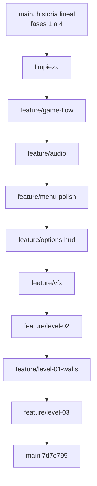

# Echoryx: historial de desarrollo

## Fuentes y alcance

| Campo | Valor |
|---|---|
| Estado descrito | Rama `main`, commit `7d7e795` (2026-11-27) |
| Fuentes | `git log`, contenido de los commits, documentación de `docs/` y `docs/archivo/` |
| Documento relacionado | [Technical Design Document](technical-design-document.md) |
| Documento de diseño | [GDD v1.0 (docs/GDD.md)](GDD.md) |

**Advertencias de lectura.**

- Las fechas y horas son las que registra Git. Varios grupos de commits comparten el mismo minuto o segundo (por ejemplo, los lotes de limpieza L1 a L9, todos a las 13:54). Indican cuándo se registraron los cambios, no cuánto duró el trabajo. El tiempo dedicado está **por verificar**.
- Los documentos de `docs/archivo/` describen etapas anteriores y no el proyecto actual.
- Las aprobaciones manuales y los resultados de pruebas citados proceden de la documentación o de mensajes de commit de su momento. No se repitieron al redactar este documento.
- Las etiquetas S00 a S05 proceden del [plan de desarrollo](development-plan.md).
- Cuando una fuente no explica el motivo de una decisión, se indica «por verificar».

---

## 1. Cronología por fases

### Resumen

| Fase | Fechas (2026) | Rama o integración | Contenido |
|---|---|---|---|
| 1. Fundación y mecánicas | 10-08 | Historia lineal en `main` | S00 a S03 |
| 2. Checkpoints y evaluación visual | 10-09 | Historia lineal en `main` | S04, S05-A y S05-B3 |
| 3. Integración del primer personaje | 10-29 | Historia lineal en `main` | S05-B4 e informe de avance |
| 4. Primer nivel y robot | 11-09 | Historia lineal en `main`; etiqueta `pre-limpieza` | `Level_01_Tutorial`, arte y robot |
| 5. Limpieza | 11-26 | `limpieza`, integrada sin commit de fusión | Lotes L1 a L9 |
| 6. Flujo, audio y presentación | 11-26 | Cinco ramas `feature/*` | Menú, audio, interfaz y efectos |
| 7. Niveles 2 y 3 y cerramiento | 11-26 y 11-27 | Tres ramas `feature/*` | Dos niveles y corrección visual |

### Fase 1. Fundación y mecánicas temporales (2026-10-08)

| Commit | Hito |
|---|---|
| `2fdb54b` | Registro inicial del repositorio |
| `aa2f2c5` | S00: proyecto Unity |
| `871f837` | S01: controlador en tercera persona |
| `fbc6240` | S02: grabación y reproducción de Echo, placa y puerta |
| `fc73688` | S03: Rewind y rompecabezas de plataforma |

Pruebas al cierre de la fase: 48 EditMode.

### Fase 2. Checkpoints y evaluación visual (2026-10-09)

| Commit | Hito |
|---|---|
| `2cd3002` | S04: checkpoints, reinicio coordinado y sala combinada en `Prototype` |
| `039cc89` | S05-A1: subconjunto de Quaternius y materiales URP |
| `ad2f52f` | S05-A2: sala de referencia visual |
| `c22e495` | S05-B2: validación del personaje SuperSoldier |
| `76cda9f` | S05-B3: laboratorio de locomoción |
| `3da3be9` | Registro de aprobaciones y retirada del candidato descartado (S05-B1) |
| `1b3035b` | Cierre de la escena de referencia |

Pruebas al cierre: 87 EditMode y 19 PlayMode.

### Fase 3. Integración del primer personaje (2026-10-29)

| Commit | Hito |
|---|---|
| `3a855e2` | Animación del SuperSoldier conectada con `PlayerMotor` |
| `e0a2466` | README e [informe de avance](archivo/informe-avance-proyecto.md) |

Pruebas al cierre: 91 EditMode y 25 PlayMode.

### Fase 4. Primer nivel y robot (2026-11-09)

| Commit | Hito |
|---|---|
| `329e5d1` | Recursos esenciales de TextMeshPro |
| `a0916b1` | `Level_01_Tutorial` |
| `97446e2`, `8c8773a` | Kits de Kenney y pase de arte |
| `1f31e31` | Correcciones visuales del pase de arte |
| `b35fe88` | Robot animado para jugador y Echo |
| `32cba38` | Echo reutilizable y plataforma aparcada tras reaparecer |
| `96d67db` | Indicadores de interacción y pulido de la animación |
| `2582fc2` | El paquete del robot se excluye de Git por su licencia (etiqueta `pre-limpieza`) |

Pruebas al cierre: 120 EditMode y 35 PlayMode.

### Fase 5. Limpieza del proyecto (2026-11-26)

La [auditoría](archivo/cleanup-audit.md) clasificó los recursos por su uso, simuló lotes sobre una copia y propuso un orden de borrado.

| Commit | Lote |
|---|---|
| `a233451` | Actualización a Unity `6000.3.29f1` |
| `2e9efc1`, `2b48008`, `8f82944` | L1 a L3: plantilla URP y recursos de Kenney sin uso |
| `7c8da0e` | Conservación de la cobertura de pruebas del motor antes de L4 |
| `0bab938`, `f8e258a`, `306f135` | L4a a L4c: retirada del SuperSoldier |
| `48f892b` | Atribución del recurso retirado |
| `4246301` | L5: archivo de documentos y evidencia |
| `6db6deb` | L6: retirada de Quaternius y sus laboratorios |
| `e41d299`, `effecdd` | L7 y L8: instaladores S01 a S04 y escena `Laboratory` |
| `c6cdddf` | L9: build, versión de Unity y nota sobre el robot |
| `7acf9b5` | Archivo del informe de auditoría |

Pruebas tras L9: 113 EditMode y 17 PlayMode. La reducción de PlayMode refleja en su mayor parte la retirada de pruebas de recursos eliminados.

### Fase 6. Flujo, audio y presentación (2026-11-26)

| Rama | Fusión | Commits propios | Contenido y commits clave | Pruebas al cierre (EditMode / PlayMode) |
|---|---|---:|---|---|
| `feature/game-flow` | `ccb8fc6` | 9 | Catálogo y progreso (`e2659bb`), menú (`d45ff0c`), pausa (`0046d1c`), fin de nivel (`4cfb79f`), diagnóstico de entrada (`ca402ee`) | 124 / 39 |
| `feature/audio` | `6a6b4f4` | 7 | Mixer y gestor (`acaa908`), bucles del Echo (`84c47a0`), clips (`627ace5`), música (`cf49150`) | 124 / 42 |
| `feature/menu-polish` | `272a608` | 3 | Fuentes (`6a9eeb9`), menú animado y fundidos (`2db2960`); partió de `feature/audio` | 124 / 44 |
| `feature/options-hud` | `26f9ec5` | 8 | Créditos (`b16825b`), opciones (`216a135`), HUD (`0c12805`), colores del robot (`141290b`, `7d9ace5`), sonido de Rewind (`2ff8783`) | 131 / 49 |
| `feature/vfx` | `7ac6a0e` | 3 | Emisor (`0245d81`), efectos (`c275b34`), pruebas (`f5f5093`) | 131 / 54 |

### Fase 7. Niveles 2 y 3 y cerramiento (2026-11-26 y 2026-11-27)

| Rama | Fusión | Commits propios | Contenido y commits clave | Pruebas al cierre (EditMode / PlayMode) |
|---|---|---:|---|---|
| `feature/level-02` | `4d98e87` | 9 | Puertas con varias placas (`95f718e`), nivel (`995838b`), recorridos medidos (`351582e`), correcciones (`10f75dc`, `5bac662`, `7658f7f`) | 131 / 58 |
| `feature/level-01-walls` | `4623e7c` | 2 | `LevelEnclosure` (`7c272f4`) y cerramiento del nivel 1 (`5188157`); partió de `feature/level-02` | 131 / 58 |
| `feature/level-03` | `7d7e795` | 6 | Prueba en rojo (`4f30878`), nivel (`e311dfd`) y documentación (`9685c30`) | 131 / 64 |

El ciclo rojo a verde del nivel 3 se detalla en el [TDD, sección 5.4](technical-design-document.md#54-ciclo-rojo-a-verde-del-nivel-3).

El diagrama muestra la sucesión del trabajo, no la topología exacta de Git; las fusiones figuran en las tablas.

Los recuentos de pruebas de esta sección son conteos estáticos del código en el commit de cierre de cada fase o rama. Indican pruebas existentes, no resultados de ejecución.

---

## 2. Decisiones y su porqué

### 2.1 Mecánicas

| Decisión | Motivo registrado | Fuente |
|---|---|---|
| Rewind actúa sobre mecanismos concretos, no sobre el mundo | Evitar acoplar la mecánica al estado global | [architecture](architecture.md) |
| La plataforma conserva su historial mientras espera en destino | Impedir que las poses estáticas expulsen el origen de la ventana de cinco segundos | [architecture](architecture.md) |
| El Echo no tiene física | No bloquear al jugador; las placas lo detectan por posición | [architecture](architecture.md) |
| La grabación del Echo es reutilizable | Motivo por verificar; el cambio de comportamiento está documentado | `32cba38`, [level-01-tutorial](level-01-tutorial.md) |
| La reaparición conserva la grabación | La documentación indica que no había razón técnica para borrarla | [level-01-tutorial](level-01-tutorial.md) |
| La plataforma queda aparcada tras reaparecer | Sin ello podía alcanzarse andando, sin usar Rewind | [level-01-tutorial](level-01-tutorial.md) |
| Puertas con varias placas (`extraPlates`) | Requerido por el nivel 2; vacío por defecto para no alterar las puertas existentes | `95f718e`, [level-02](level-02.md) |

### 2.2 Personaje, arte y recursos

| Decisión | Motivo registrado | Fuente |
|---|---|---|
| Descartar Cybernet Warrior | Sin esqueleto, skinning ni Avatar; 157.410 triángulos | [character-visual-assets](character-visual-assets.md) |
| Adoptar el SuperSoldier | Rig y Avatar Humanoid válidos | [validación](archivo/supersoldier-validation.md) |
| Sustituir el SuperSoldier por el robot | Por verificar | `b35fe88` |
| Pasar de Quaternius a los kits de Kenney | Por verificar; la auditoría registra que Quaternius no se usaba en el nivel | `8c8773a`, [auditoría](archivo/cleanup-audit.md) |
| No versionar el paquete del robot | La EULA del Asset Store no permite redistribuir los fuentes y el repositorio se declara público | [credits](credits.md) |
| Sintetizar el sonido de Rewind | El primer clip concentraba casi toda su energía por debajo de 150 Hz; el definitivo no usa material de terceros | `49d53ca`, `2ff8783`, [audio](audio.md) |
| Elegir la variante C de las tres sintetizadas | Por verificar | `2cd031f`, `2ff8783` |
| Color ámbar y ojos blanco cálido en el robot; cian solo en el Echo | La regla del cian está documentada; el motivo del ámbar está por verificar | `141290b`, `7d9ace5`, [vfx](vfx.md) |

### 2.3 Arquitectura y flujo

| Decisión | Motivo registrado | Fuente |
|---|---|---|
| Menús creados por código y `LevelFlow` añadido en ejecución | Reconstruir un nivel no puede borrar los menús | [game-flow](game-flow.md) |
| Audio y efectos añadidos en ejecución | No requieren cableado en las escenas y solo leen estado público | [audio](audio.md), [vfx](vfx.md) |
| Retroceso para reiniciar el nivel | R ya estaba asignada al checkpoint | [game-flow](game-flow.md) |
| Pausa con medidas además de `timeScale = 0` | `Update` y `LateUpdate` siguen ejecutándose | [game-flow](game-flow.md) |
| Catálogo de niveles como `ScriptableObject` | Añadir un nivel sin tocar código | [game-flow](game-flow.md) |
| Actualizar a Unity `6000.3.29f1` | Por verificar | `a233451` |

### 2.4 Proceso y niveles

| Decisión | Motivo registrado | Fuente |
|---|---|---|
| Limpiar por lotes, con suites entre lotes | Respetar dependencias y detectar roturas | [auditoría](archivo/cleanup-audit.md) |
| Archivar la documentación antigua en lugar de borrarla | Conservarla como registro | `4246301`, `6db6deb` |
| Mantener la atribución del SuperSoldier | Los archivos siguen en el historial y en las capturas | `48f892b`, [credits](credits.md) |
| Cerrar el nivel 2 sin decorado flotante | Se diseñó como sección de estación cerrada | [level-02](level-02.md) |
| Acelerar 1,6 veces las plataformas de las salas 2 y 3 del nivel 2 | Por verificar; los márgenes se volvieron a medir | `5bac662`, `7658f7f` |
| Extraer `LevelEnclosure` | Compartir la solución de rendijas entre niveles | `7c272f4` |
| Elevadores del nivel 3 con viaje de ida hacia una zona letal, en lugar del ciclo único de ida y vuelta pactado | Un elevador que regresa queda quieto y accesible: bastaría grabarse sobre él, sin Rewind. Además no requiere código nuevo | [level-03](level-03.md) |
| Escribir la prueba del nivel 3 antes que el nivel | Los mensajes de commit declaran el ciclo rojo a verde; el motivo no está registrado en el repositorio: por verificar | `4f30878` |

---

## 3. Problemas encontrados y resolución

| Fase | Problema | Resolución | Fuente |
|---|---|---|---|
| S04 | Tras reiniciar en la sala B se podía embarcar en el viaje inicial sin Rewind | Se trasladó el checkpoint al inicio del acceso; una prueba conserva el punto antiguo en memoria para reproducir el atajo | [testing](testing.md#corrección-final-s04-acceso-b-tras-reinicio) |
| S04 y S05 | El batchmode no tiene la vista de juego enfocada y fallaba la entrada de las pruebas | Se usó una copia temporal de los ajustes del Input System | [testing](testing.md) |
| S05-B3 | La revisión manual rechazó la locomoción aunque las pruebas pasaban: no medían el retargeting ni el contacto en todo el ciclo | Se corrigió la referencia de los Avatars y se añadieron mediciones de la malla | [locomoción](archivo/supersoldier-locomotion.md) |
| S05-B3 | El personaje flotaba durante la preparación del salto, hasta 35,4 cm | Se generó una copia del clip que limita la curva vertical | [locomoción](archivo/supersoldier-locomotion.md) |
| Nivel 1 | La hoja de la puerta y la plataforma no se movían visualmente | Los elementos móviles dejaron de marcarse como *Batching Static* | `1f31e31` |
| Nivel 1 | Parpadeo del suelo y cámara atravesando paredes | Nuevo rango de profundidad, `CinemachineDeoccluder` y mayor radio de cámara | `1f31e31` |
| Nivel 1 | Tras reaparecer, la plataforma era alcanzable sin Rewind | `ParkAtDestination` y `ParkedPlatformAttemptReset` | `32cba38` |
| Nivel 1 | Las pistas superpuestas dejaban la etiqueta vacía | La etiqueta recupera la pista anterior aún activa | `32cba38` |
| Limpieza | Al retirar pruebas antiguas se podía perder cobertura de `PlanarSpeed` | Las pruebas se trasladaron antes de borrar | `7c8da0e` |
| Limpieza | Un constructor activo abría por ruta un laboratorio que iba a retirarse | Se eliminó esa llamada en el mismo lote | `0bab938` |
| Limpieza | La atribución del personaje solo constaba en carpetas que iban a borrarse | Se añadió a `credits.md` antes de borrar | `48f892b` |
| Limpieza | Un build habría arrancado en `Prototype` | Se reordenó el build | `c6cdddf` |
| Flujo | El retículo de Rewind se dibujaba sobre los menús | `RewindInteractor` se desactiva mientras hay un menú | `6fbbc80` |
| Flujo | Pausar en el fotograma equivocado perdía transporte sobre la plataforma | El motor se congela solo con `deltaTime` igual a cero y se reactiva en `LateUpdate` | `0046d1c`, [game-flow](game-flow.md) |
| Flujo | Errores del Input System «count in old and new state must be the same» | Diagnóstico: solo en el Editor, al cambiar la forma del activo de acciones; sin cambios de código; se añadieron pruebas | `1648cc8`, `ca402ee` |
| Flujo | Conectar un dispositivo suelta un Rewind mantenido | Documentado; sin corregir, porque implicaba cambiar la lógica de Rewind | [game-flow](game-flow.md) |
| Audio | El sonido de Rewind apenas se oía | Copia con graves recortados, después filtro a 500 Hz y finalmente un sonido sintetizado | `49d53ca`, `7253a46`, `2ff8783` |
| Interfaz | El título se solapaba en el selector de niveles | Nueva separación y prueba en 16:9, 16:10 y 4:3 | `10f75dc` |
| Nivel 2 | Se veía el exterior por rendijas y la placa del pozo se distinguía mal | Fosos cerrados, paneles de fondo, pilares, indicador reforzado y luz | `5bac662`, `7658f7f` |
| Nivel 1 | Presentaba el mismo problema de rendijas | Se compartió la solución con `LevelEnclosure`. La prueba de arte se ajustó para admitir los cubos del cerramiento | `7c272f4`, `5188157` |
| Nivel 3 | La compuerta cerrada impide apuntar a la plataforma aparcada detrás | La prueba pasó a exigir abrirla con el Echo, sujetar con Rewind y llamar al Echo otra vez | `62448bc`, [level-03](level-03.md) |
| Nivel 3 | La medición del puente no partía de su posición más baja | La prueba espera a que el puente baje antes de medir | `24b061d` |
| Nivel 3 | Completar el nivel retira los controles antes de llegar a un punto exacto | La prueba avanza hasta que se registra la finalización | `24b061d` |

### Evolución de márgenes del nivel 2

| Momento | Sala 1 | Sala 2 | Sala 3 |
|---|---:|---:|---:|
| Tras `4336197` | 3,95 s | 1,43 s | 2,57 s |
| Tras `4738e03` | 3,95 s | 2,57 s | 2,57 s |

### Cuestiones abiertas

- El mensaje de `7c272f4` afirma que la refactorización mantiene la misma salida en el nivel 2. Ese commit no modifica la escena y ningún commit posterior la regenera: la afirmación está **por verificar**.
- No hay constancia de un build ejecutable comprobado.
- La lista completa de riesgos está en el [TDD, sección 10](technical-design-document.md#10-riesgos-y-deuda-técnica-conocida).

---

## 4. Métricas

Todas las cifras corresponden a `main` en `7d7e795`; no incluyen los commits de esta documentación.

### 4.1 Commits y ramas

| Métrica | Valor |
|---|---:|
| Commits | 95 |
| Commits de fusión | 8 |
| Commits sin fusiones | 87 |
| Ramas de trabajo visibles (`limpieza` y ocho `feature/*`) | 9 |
| Etiquetas | 1 (`pre-limpieza`) |
| Días con commits | 6, entre 2026-10-08 y 2026-11-27 |

| Fecha | 10-08 | 10-09 | 10-29 | 11-09 | 11-26 | 11-27 |
|---|---:|---:|---:|---:|---:|---:|
| Commits | 5 | 9 | 2 | 9 | 54 | 16 |

### 4.2 Evolución de las pruebas

| Hito | Commit | EditMode | PlayMode | Total |
|---|---|---:|---:|---:|
| S01 | `871f837` | 3 | 0 | 3 |
| S02 | `fbc6240` | 21 | 0 | 21 |
| S03 | `fc73688` | 48 | 0 | 48 |
| S04 | `2cd3002` | 83 | 5 | 88 |
| Cierre de S05-B3 | `1b3035b` | 87 | 19 | 106 |
| S05-B4 | `3a855e2` | 91 | 25 | 116 |
| Nivel 1 | `a0916b1` | 99 | 27 | 126 |
| Antes de la limpieza | `96d67db` | 120 | 35 | 155 |
| Cobertura conservada | `7c8da0e` | 120 | 37 | 157 |
| Tras la limpieza | `c6cdddf` | 113 | 17 | 130 |
| Flujo de juego | `ca402ee` | 124 | 39 | 163 |
| Audio | `8e2634c` | 124 | 42 | 166 |
| Presentación del menú | `2db2960` | 124 | 44 | 168 |
| Opciones y HUD | `2ff8783` | 131 | 49 | 180 |
| Efectos visuales | `f5f5093` | 131 | 54 | 185 |
| Niveles 2 y cerramiento | `5188157` | 131 | 58 | 189 |
| Nivel 3 | `7d7e795` | 131 | 64 | 195 |

**Método.** Conteo estático por commit (`[Test]`, `[UnityTest]` y un caso por `[TestCase]`). En los commits contrastados (`7c8da0e`, `c6cdddf`, `2ff8783` y `5188157`) coincide con los totales anotados en sus mensajes. El resultado de ejecutar las 195 pruebas en `7d7e795` está **por verificar**, porque no hay un informe versionado.

### 4.3 Contenido

| Métrica | Valor |
|---|---:|
| Niveles en el catálogo | 3 |
| Escenas en `Assets/_Echoryx/Scenes/` | 6 (menú, tres niveles, `Prototype` y `RobotIntegrationLab`) |
| Ensamblados propios | 30 (11 de ejecución, 5 de Editor y 14 de pruebas) |

| Código C# | Archivos | Líneas |
|---|---:|---:|
| Ejecución | 90 | 6.143 |
| Editor | 12 | 3.223 |
| Pruebas | 41 | 6.993 |

Las líneas incluyen comentarios y líneas en blanco.

---

## 5. Lecciones aprendidas

Estas lecciones son una síntesis elaborada a partir de los incidentes anteriores. El repositorio no contiene una retrospectiva del equipo; su ratificación está **por verificar**.

1. **Una suite en verde no valida el aspecto.** En S05-B3 las pruebas pasaban y la revisión manual rechazó la animación. Hacen falta mediciones que representen lo que se percibe, además de revisión visual.
2. **Antes de borrar, hay que revisar cobertura, referencias por ruta y atribuciones.** La limpieza encontró los tres tipos de dependencia.
3. **Una optimización de render puede romper el comportamiento visible.** El batching estático inmovilizó elementos móviles.
4. **La reaparición forma parte del diseño del rompecabezas.** Tanto la sala B de `Prototype` como la plataforma del nivel 1 ofrecieron atajos tras reiniciar.
5. **Cada solución esperada necesita su solución falsa.** Las pruebas de los niveles 2 y 3 comprueban trampas que deben fallar, además del recorrido correcto.
6. **Los márgenes deben medirse en el peor caso.** En el nivel 3 hubo que dejar bajar el puente antes de medir.
7. **Escribir la prueba primero no la hace definitiva.** En el nivel 3 la prueba cambió dos veces; esos cambios conviene registrarlos y explicarlos.
8. **Para acreditar un ciclo de TDD, cada estado debe dejar evidencia.** Commits registrados en bloque y salidas de pruebas sin versionar limitan lo que puede comprobarse después.
9. **Un mensaje de commit solo debe afirmar lo comprobado.** La equivalencia declarada en `7c272f4` no tiene respaldo en el repositorio.
10. **Las pruebas con entrada simulada dejan huecos conocidos.** La cámara de prueba no valida la puntería real, y el batchmode sin gráficos no valida la imagen.
11. **La documentación se desactualiza si no cambia con el código.** El TDD recoge varias discrepancias en su [sección 10.4](technical-design-document.md#104-documentación-desactualizada).
