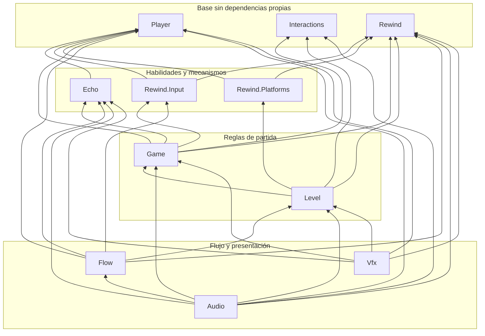
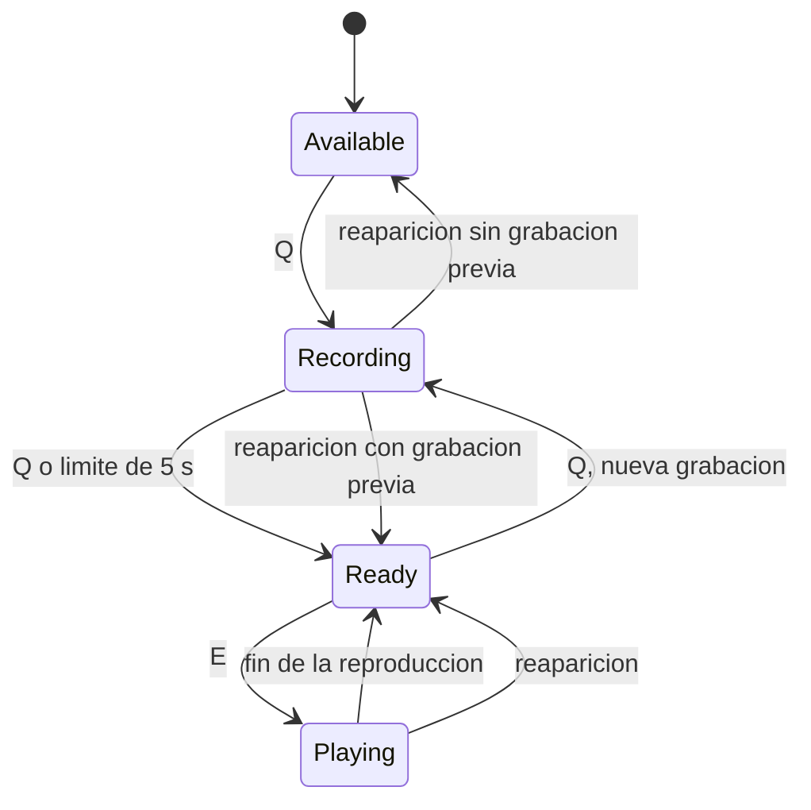
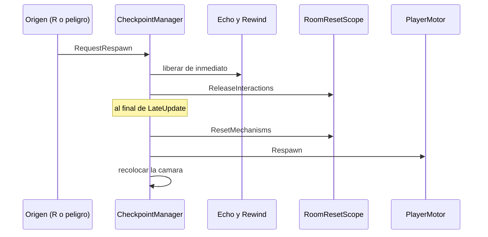
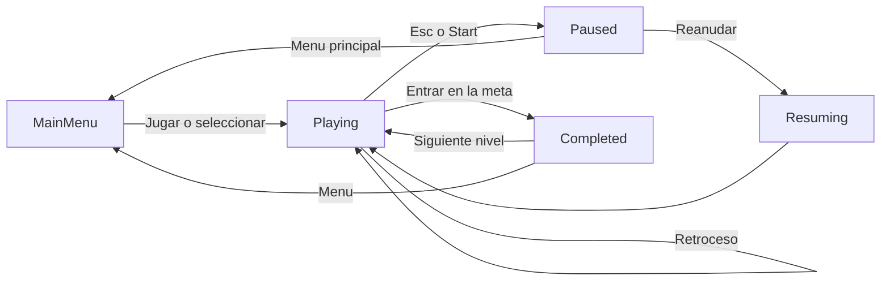
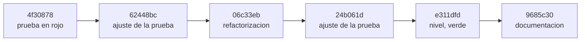

# Echoryx: Technical Design Document

## Control del documento

| Campo | Valor |
|---|---|
| Estado descrito | Rama `main`, commit `7d7e795` (2026-11-27) |
| Motor | Unity `6000.3.29f1` |
| Documento de diseño de referencia | [GDD v1.0 (docs/GDD.md)](GDD.md) |
| Documento relacionado | [Historial de desarrollo](historial-desarrollo.md) |

**Sobre las versiones del GDD.** El documento de referencia es el [GDD v1.0 (docs/GDD.md)](GDD.md). Según su encabezado, está actualizado al estado implementado el 27 de noviembre de 2026, la versión 0.2 es el diseño original y su sección 16 registra los cambios. El documento 0.2 no está identificado como tal en el repositorio: que el `docs/GDD.md` presente en `7d7e795` corresponda a esa versión está **por verificar**.

**Criterio de redacción.** Las afirmaciones proceden del código, la configuración, el historial de Git y la documentación versionada. Lo que no puede confirmarse con esas fuentes se marca como «por verificar».

## Índice

1. [Resumen y alcance](#1-resumen-y-alcance)
2. [Arquitectura](#2-arquitectura)
3. [Sistemas](#3-sistemas)
4. [Herramientas de edición y generación de niveles](#4-herramientas-de-edición-y-generación-de-niveles)
5. [Estrategia de pruebas y TDD](#5-estrategia-de-pruebas-y-tdd)
6. [Persistencia](#6-persistencia)
7. [Rendimiento y compatibilidad](#7-rendimiento-y-compatibilidad)
8. [Recursos de terceros y licencias](#8-recursos-de-terceros-y-licencias)
9. [Desviaciones respecto al GDD 0.2](#9-desviaciones-respecto-al-gdd-02)
10. [Riesgos y deuda técnica conocida](#10-riesgos-y-deuda-técnica-conocida)

---

## 1. Resumen y alcance

Echoryx es un videojuego 3D en tercera persona de rompecabezas y plataformas basado en dos habilidades temporales:

- **Echo:** graba hasta cinco segundos de la pose del jugador y la reproduce cuando el jugador lo decide.
- **Rewind:** retrocede el movimiento de un mecanismo concreto, al que el jugador apunta. No rebobina el mundo ni al jugador.

El estado descrito incluye un menú principal, tres niveles encadenados, pausa, progreso guardado, opciones, créditos, audio, efectos visuales y un personaje robot animado.

| Orden | Identificador | Nombre en el catálogo | Escena | Detalle |
|---|---|---|---|---|
| 1 | `level-01-tutorial` | Tutorial | `Level_01_Tutorial` | [level-01-tutorial](level-01-tutorial.md) |
| 2 | `level-02-sincronia` | Sincronía | `Level_02_Sincronia` | [level-02](level-02.md) |
| 3 | `level-03-paradojas` | Paradojas | `Level_03_Paradojas` | [level-03](level-03.md) |

### Trazabilidad con GDD v1.0 (docs/GDD.md)

| Elemento del GDD v1.0 (docs/GDD.md) | Cobertura técnica | Estado en `7d7e795` |
|---|---|---|
| Cámara en tercera persona | 3.2 | Implementado |
| Echo de hasta cinco segundos con inicio manual | 3.3 | Implementado; ver diferencias en 9.2 |
| Rewind dirigido; el mecanismo continúa desde el estado recuperado | 3.4 | Implementado |
| Checkpoints | 3.6 | Implementado |
| Tres niveles cortos | 3.7 y 4 | Tres niveles en el catálogo. Su duración jugada está por verificar |
| Desafío final (fuera de la versión actual) | Sin sistema asociado | No implementado, conforme al alcance |
| Protagonista robótico | 3.11 | Implementado; ver diferencias en 9.2 |

Fuera del alcance de este documento: especificación artística, guion y planificación académica.

---

## 2. Arquitectura

### 2.1 Plataforma

| Componente | Versión o valor | Fuente |
|---|---|---|
| Unity Editor | `6000.3.29f1` (`96d2fe17529c`) | `ProjectSettings/ProjectVersion.txt` |
| Universal Render Pipeline | `17.3.0` | `Packages/manifest.json` |
| Input System | `1.20.1`; solo el sistema nuevo (`activeInputHandler: 1`) | manifest y `ProjectSettings` |
| Cinemachine | `3.1.7` | manifest |
| Unity Test Framework | `1.6.0` | manifest |
| uGUI (incluye TextMeshPro) | `2.0.0` | manifest; recursos TMP en `Assets/TextMesh Pro/` |
| Espacio de color | Lineal (`m_ActiveColorSpace: 1`) | `ProjectSettings` |
| Producto y versión | `Echoryx`, `0.1.0` | `ProjectSettings` |

### 2.2 Carpetas

| Ruta | Contenido |
|---|---|
| `Assets/_Echoryx/Scripts/` | Código en tiempo de ejecución y de Editor, separado por sistema. `UI/` solo contiene `.gitkeep`; la interfaz vive en `Flow/` y `Level/` |
| `Assets/_Echoryx/Tests/` | Pruebas `Editor/` (EditMode) y `PlayMode/` |
| `Assets/_Echoryx/Scenes/` | `MainMenu`, los tres niveles, `Prototype` y `RobotIntegrationLab` |
| `Assets/_Echoryx/Prefabs/` | `Player`, `EchoActor`, piezas de nivel (`Level/`) y visuales del robot (`Characters/`) |
| `Assets/_Echoryx/Resources/` | Recursos cargados en ejecución: catálogo de niveles, librería de audio, fuentes TMP, materiales de efectos y créditos |
| `Assets/_Echoryx/{Art,Audio,Fonts,Materials,Settings}/` | Arte, sonido, tipografías, materiales y perfil de volumen |
| `Assets/Settings/` | Activos de URP (perfiles PC y Mobile) |
| `Assets/InputSystem_Actions.inputactions` | Mapas `Player`, `UI` y `System` |
| `Tools/audio/` | Script de síntesis del sonido de Rewind |
| `docs/` | Documentación; `docs/archivo/` conserva evidencia de etapas retiradas |

Las escenas, los prefabs y los activos se generan o modifican mediante las API del Editor. La regla del proyecto (`AGENTS.md`) prohíbe editar a mano el YAML de las escenas.

### 2.3 Ensamblados

El proyecto define 30 ensamblados propios: 11 de ejecución, 5 de Editor y 14 de pruebas (8 EditMode y 6 PlayMode).

| Ensamblado de ejecución | Dependencias propias |
|---|---|
| `Echoryx.Player` | Ninguna |
| `Echoryx.Interactions` | Ninguna |
| `Echoryx.Rewind` | Ninguna |
| `Echoryx.Echo` | Player |
| `Echoryx.Rewind.Input` | Rewind, Player |
| `Echoryx.Rewind.Platforms` | Rewind, Player |
| `Echoryx.Game` | Player, Echo, Rewind, Rewind.Input, Interactions |
| `Echoryx.Level` | Game, Interactions, Rewind, Rewind.Platforms |
| `Echoryx.Flow` | Level, Echo, Player, Rewind, Rewind.Input |
| `Echoryx.Audio` | Flow, Level, Game, Player, Echo, Interactions, Rewind |
| `Echoryx.Vfx` | Level, Game, Player, Echo, Rewind |

Ensamblados de Editor: `Echoryx.Level.Editor`, `Echoryx.Flow.Editor`, `Echoryx.Audio.Editor`, `Echoryx.Vfx.Editor` y `Echoryx.Player.Editor`.

La flecha del diagrama significa «depende de».



### 2.4 Composición en tiempo de ejecución

El flujo, el audio y los efectos no se guardan en las escenas de nivel. Tres clases de arranque se registran con `RuntimeInitializeOnLoadMethod` y reaccionan a `SceneManager.sceneLoaded`:

| Arranque | Condición | Resultado |
|---|---|---|
| `LevelFlowBootstrap` | La escena figura en el `LevelCatalog` | Instala `LevelFlow` (pausa, reinicio, botones de fin, HUD del Echo) |
| `AudioBootstrap` | Cualquier escena; los eventos de juego requieren un `CheckpointManager` | Selecciona la música, conecta el sonido de botones y añade `GameAudioEvents` |
| `VfxBootstrap` | La escena tiene un `CheckpointManager` | Crea `GameVfx` |

Consecuencia de diseño: reconstruir una escena de nivel no elimina menús, sonido ni efectos.

### 2.5 Orden de ejecución

Varias reglas dependen del orden de actualización, fijado con `DefaultExecutionOrder`. `PlayerMotor` usa el orden por defecto (0).

| Orden | Componentes |
|---:|---|
| -500 | `LevelFlow` |
| -200 | `RestartInput` |
| -100 | `RewindMovingPlatform` |
| 0 | `PlayerMotor` (por defecto) |
| 20 | `RobotAnimationDriver` |
| 40 / 50 / 60 | Entradas de Echo / `EchoRecorder` / `EchoPlayback` |
| 100 / 110 | `PlayerCameraOrbit` / `RewindInteractor` |
| 120 / 130 | `PressurePlate` / `PressurePlateEvents` |
| 140 | `DoorController`, `RewindableMechanism` (la plataforma lo sustituye por -100) |
| 150 a 300 | Seguimiento visual, estadísticas, indicadores y HUD del Echo |
| 1000 | `CheckpointManager` |
| 1100 | `GameAudioEvents`, `GameVfx` |

---

## 3. Sistemas

### 3.1 Movimiento del jugador

**Responsabilidad.** `PlayerMotor` es la única autoridad sobre el desplazamiento del personaje.

**Clases clave.** `PlayerMotor`, `PlayerInputReader`, `JumpWindow`, `PlayerPlatformCarrier`, `PlatformRidePolicy`, `ResolvedPlanarMotion`, `InputReleaseGate`.

**Datos** (valores serializados en `Player.prefab`):

| Parámetro | Valor |
|---|---|
| Velocidad máxima | 6 m/s |
| Aceleración / frenado | 20 / 25 m/s² |
| Control aéreo | 0,55 |
| Velocidad de giro | 720 grados/s |
| Altura de salto / gravedad | 1,65 m / -24 m/s² |
| Coyote time / buffer de salto | 0,12 s / 0,12 s |

**Flujo por fotograma.**

1. Lee movimiento y salto desde `PlayerInputReader`.
2. Calcula la dirección respecto al plano horizontal de la cámara.
3. Aplica aceleración, gravedad y salto mediante `JumpWindow`.
4. Suma el desplazamiento de plataforma pendiente de `PlayerPlatformCarrier`.
5. Ejecuta una sola llamada a `CharacterController.Move`.
6. Publica `PlanarSpeed`, que excluye el transporte y el movimiento bloqueado por paredes.

**Decisiones.**

- El jugador no se hace hijo de la plataforma ni se teletransporta: la plataforma ofrece su desplazamiento y el motor lo integra.
- Solo se transporta a quien estaba apoyado sobre la cara superior; un contacto lateral no cuenta.
- `Respawn` limpia velocidades, ventanas de salto y transporte pendiente, y desactiva temporalmente el `CharacterController`.
- Tras una reaparición, `InputReleaseGate` exige soltar las acciones que seguían pulsadas.

### 3.2 Cámara

**Responsabilidad.** Seguir y orbitar al jugador sin atravesar geometría.

**Clases y componentes clave.** `PlayerCameraOrbit`, `CinemachineCamera`, `CinemachineThirdPersonFollow`, `CinemachineDeoccluder`.

**Datos.** Distancia 4 m; sensibilidad de ratón 0,15; inclinación entre -55 y 70 grados. El ajuste común (`Level01ArtPass.ConfigureCamera`) fija planos de recorte 0,25 y 300, radio de colisión 0,4 y colisión contra la capa `Default`.

**Flujo.** `PlayerCameraOrbit` mueve un objetivo independiente de la rotación del personaje; Cinemachine sigue ese objetivo. Al reaparecer, `CheckpointManager` recoloca el objetivo y notifica el salto de posición a Cinemachine.

**Decisiones.** El mismo montaje (`CreatePlayerRig`) y el mismo ajuste de cámara se reutilizan en los constructores de niveles. El rango de profundidad se redujo para corregir el parpadeo del suelo (commit `1f31e31`).

### 3.3 Echo

**Responsabilidad.** Capturar la pose del jugador y reproducirla en un clon.

**Clases clave.** `EchoCapture`, `EchoRecording`, `EchoSample`, `EchoState`, `EchoRecorder`, `EchoPlayback`, `EchoActor`, `EchoRecordInput`, `EchoPlaybackInput`.

**Datos.** Máximo 5 s; 20 muestras por segundo; cada muestra contiene tiempo relativo, posición y rotación. El búfer es de tamaño fijo.

**Flujo.**



La cancelación explícita (`Cancel`) descarta la grabación y vuelve a `Available`; no se representa en el diagrama.

**Decisiones.**

- La reproducción parte de la primera pose grabada, no de la posición actual del jugador.
- La grabación es reutilizable. Una grabación nueva reemplaza a la anterior solo cuando termina.
- La reaparición conserva la última grabación terminada y elimina el clon.
- El clon no tiene `Collider`, `CharacterController` ni `Rigidbody`: no bloquea al jugador.
- Con un clon activo, una segunda pulsación de E se ignora.
- Se graba la trayectoria, no las acciones ni las interacciones.
- La captura usa tiempo escalado, por lo que la pausa la detiene.

### 3.4 Rewind

**Responsabilidad.** Mantener el historial local de un mecanismo y retrocederlo mientras el jugador lo sujeta.

**Clases clave.** `RewindHistory`, `RewindableMechanism`, `IRewindableMechanism`, `RewindInteractor`, `RewindTargetResolver`, `RewindSelectionSession`, `RewindMovingPlatform`, `MovingPlatformPath`.

**Datos.** Anillo de capacidad fija; ventana máxima de 5 s; 20 muestras por segundo; alcance de selección de 12 m desde la cámara. La velocidad de retroceso (`rewindSpeed`) se configura en cada mecanismo.

**Flujo.**

1. `RewindInteractor` lanza un rayo desde el centro de la cámara e ignora los colisionadores del jugador.
2. El primer obstáculo determina el objetivo; un objeto intermedio bloquea la selección.
3. `RewindSelectionSession` adquiere como máximo un mecanismo por pulsación y lo mantiene hasta soltar el botón.
4. Durante el retroceso no hay movimiento normal; en la muestra más antigua, el mecanismo queda quieto.
5. Al soltar, se descarta la rama futura y el mecanismo continúa desde la pose recuperada.

**Decisiones.**

- El núcleo (`Echoryx.Rewind`) no depende de entrada, cámara ni jugador.
- Solo un mecanismo puede rebobinarse a la vez.
- `RewindMovingPlatform` describe un viaje de ida. En destino deja de avanzar su reloj para no expulsar del historial el origen del viaje.
- Tras una reaparición, `ParkAtDestination` deja la plataforma aparcada en destino con historial válido (`ParkedPlatformAttemptReset`). Con ello, alcanzarla exige Rewind.

### 3.5 Mecanismos

**Responsabilidad.** Traducir la presencia del jugador o del Echo en movimiento de elementos del nivel.

**Clases clave.** `MechanismActor`, `PressurePlate`, `PlateOccupancy`, `PressurePlateEvents`, `DoorController`, `DoorGateState`, `RewindMovingPlatform`, `RespawnZone`.

**Detección.** `MechanismActor` mantiene un registro de entidades activas. `PressurePlate` comprueba sus posiciones dentro de un volumen local en cada `LateUpdate`, por lo que el Echo no necesita física.

**Variantes.** No existe una clase distinta para cada variante; se componen con dos componentes de movimiento.

| Variante | Composición | Comportamiento | Niveles |
|---|---|---|---|
| Placa | `PressurePlate` | Activa mientras el jugador o el Echo están sobre ella | 1, 2 y 3 |
| Puerta | `Door.prefab` con `DoorController` | Abre mientras su placa está activa. Admite placas adicionales (`extraPlates`) que deben estar activas a la vez | 1, 2 y 3 |
| Reja | `Grate.prefab` con `DoorController` y panel translúcido con colisionador | Bloquea el paso y la selección de Rewind | 2 y 3 |
| Compuerta colgante | Instancia de `Grate` con panel desplazado y reescalado | Deja pasar la plataforma por debajo y empuja fuera a quien va encima | 2 y 3 |
| Puente | `DoorController` cuyo panel es un tablero de colisión | «Abierto» significa elevado 6,3 m a 5 m/s; su umbral está lejos del tablero para que no retenga la apertura | 3 |
| Plataforma | `RewindMovingPlatform` | Viaje de ida entre dos marcadores | 1, 2 y 3 |
| Elevador | `RewindMovingPlatform` vertical con una placa hija | Baja 3 m (0,8 m/s; rebobinado ×1,5) hacia un pozo con zona de peligro | 3 |
| Peligro | `RespawnZone` | Solicita la reaparición al entrar el jugador | 1, 2 y 3 |

**Flujo de una puerta.** Si todas sus placas están activas, el panel se mueve hacia `openOffset`. `DoorGateState` mantiene abierta una puerta ya abierta mientras el jugador ocupe el umbral. Una puerta totalmente cerrada no se abre por proximidad.

**Decisiones.** El único cambio de código de juego introducido para el nivel 2 fue `extraPlates`, vacío por defecto. El nivel 3 no añadió código de juego: puente y elevadores se montan con componentes existentes (ver [level-03](level-03.md)).

### 3.6 Checkpoints y reaparición

**Responsabilidad.** Guardar el punto de reaparición activo y restaurar la sala asociada.

**Clases clave.** `CheckpointManager`, `CheckpointTrigger`, `RoomResetScope`, `IAttemptResetParticipant`, `EchoAttemptReset`, `RewindAttemptRelease`, `RewindMechanismAttemptReset`, `ParkedPlatformAttemptReset`, `PressurePlateAttemptReset`, `DoorAttemptReset`, `RestartInput`.

**Datos.** Pose de reaparición y sala activa en memoria. Cada `RoomResetScope` contiene una lista serializada y ordenada de participantes. El checkpoint no se guarda en disco.

**Flujo** (tecla R o zona de peligro):



**Decisiones.**

- Todas las liberaciones preceden a todas las restauraciones.
- Solo se restaura la sala activa; no hay búsquedas globales en la escena.
- La entrada en un checkpoint se detecta por posición; el Echo no activa checkpoints.
- Las solicitudes repetidas dentro del mismo intento se agrupan.

### 3.7 Flujo de juego y progreso

**Responsabilidad.** Encadenar menú y niveles, gestionar pausa, reinicio y finalización, y registrar el progreso.

**Clases clave.** `LevelCatalog`, `LevelFlow`, `LevelFlowBootstrap`, `SceneNavigator`, `SceneTransition`, `GameProgress`, `MainMenuController`; en `Level`: `GoalZone`, `LevelStats`, `LevelStatsTracker`, `LevelStatsAttemptCounter`, `LevelCompletePanel`.

**Datos.** `Resources/LevelCatalog.asset` contiene la lista ordenada (`id`, nombre, ruta), la escena de menú y el activo de acciones. El formato del progreso se describe en la sección 6.

**Flujo.**



**Decisiones.**

- La tecla R ya estaba asignada al checkpoint; el reinicio del nivel usa Retroceso.
- `timeScale = 0` no basta para pausar. Además se suspende la entrada de juego, se desactiva la órbita y se suelta el Rewind.
- `PlayerMotor` se desactiva solo en fotogramas con `deltaTime` igual a cero. Otro momento hace perder un fotograma de transporte sobre plataformas ([game-flow](game-flow.md#pausa-qué-se-congela-y-cómo)).
- Los cambios de escena pasan por `SceneNavigator`, que restablece `timeScale`; `SceneTransition` añade un fundido de 0,6 s. El reintento de nivel carga sin fundido.
- El `id` de nivel es la clave del progreso y no debe cambiar.

### 3.8 Interfaz de usuario

**Responsabilidad.** Presentar menús, ayudas, estado del Echo y resumen de nivel.

| Elemento | Origen | Clases |
|---|---|---|
| Pistas y panel de fin | Canvas generado por el constructor del nivel | `TutorialHint`, `TutorialHintDisplay`, `LevelCompletePanel` |
| Menú principal y selector | Código en ejecución | `MainMenuController`, `UiKit` |
| Pausa y botones de fin | Código en ejecución | `LevelFlow` |
| Opciones y reinicio de progreso | Código en ejecución | `OptionsPanel`, `GameSettings` |
| Créditos | Código en ejecución, a partir de `Resources/Credits/` | `CreditsPanel`, `CreditsText` |
| HUD del Echo | Código en ejecución | `EchoHud` |
| Retículo de Rewind | IMGUI (`OnGUI`) | `RewindInteractor` |
| Presentación | Animación de menú, título y botones | `MenuMotion`, `TitleEffect`, `ButtonHoverScale`, `UiFonts` |

**Datos.** El selector muestra hasta 12 niveles (3 columnas por 4 filas). Las tipografías son Orbitron (títulos) y Exo 2 (texto).

**Decisiones.** Las pistas explican reglas. El retículo IMGUI se dibuja por encima de cualquier Canvas, por lo que se desactiva mientras hay un menú (commit `6fbbc80`).

### 3.9 Audio

**Responsabilidad.** Reproducir música, efectos y bucles según el estado del juego.

**Clases clave.** `AudioManager`, `AudioLibrary`, `GameAudioEvents`, `AudioBootstrap`, `UiButtonSound`.

**Datos.** `EchoryxMixer` con grupos Master, Music y SFX. `AudioLibrary` define 16 identificadores de sonido (`SoundId`), cada uno con clips y volumen. Todo el audio es 2D.

**Flujo.** `GameAudioEvents` observa el estado público y el evento `LevelStats.Completed`, y solicita sonidos a `AudioManager`. Tras una reaparición adopta el nuevo estado sin reproducir efectos.

| Parámetro | Valor |
|---|---|
| Fundido de música (salida / entrada) | 1,5 s / 2 s |
| Fundido de bucles (Rewind y Echo) | 0,1 s |
| Nivel de música en pausa | 35 % |

**Decisiones.** El gestor persiste entre escenas. Los fundidos usan tiempo no escalado. Una entrada sin clip no produce error. Los volúmenes guardados se aplican en `Start`, porque el mixer ignora los cambios hechos en `Awake`. Detalle en [audio](audio.md).

### 3.10 Efectos visuales

**Responsabilidad.** Representar Echo, Rewind, checkpoint, meta y aterrizaje.

**Clases clave.** `GameVfx`, `VfxEmitter`, `VfxLibrary`, `VfxPalette`, `VfxBootstrap`.

**Datos.** Siete emisores de capacidad fija: 700, 24, 16, 80, 140, 220 y 90 partículas (1.270 en total). Materiales propios en `Resources/Vfx/`.

**Flujo.** `GameVfx` lee estado público después de `CheckpointManager`, de modo que una reaparición no dispara efectos. `VfxEmitter` emite sobre sistemas ya creados.

**Decisiones.** La simulación usa tiempo escalado y se congela en pausa. El cian se reserva para el Echo, regla cubierta por `OnlyTheEchoPaletteIsCyan`. Aparte de `GameVfx`, `InteractionBeacon` y `RewindMechanismFeedback` aportan indicadores propios del nivel. Detalle en [vfx](vfx.md).

### 3.11 Animación del robot

**Responsabilidad.** Animar jugador y Echo sin modificar su movimiento.

**Clases y activos clave.** `RobotAnimationDriver`, `RobotVisualBuilder`, `PlayerLocomotion.controller`, `RobotVisual.prefab`, `RobotEchoVisual.prefab`.

**Datos.** Modelo con rig Generic. Parámetros del Animator: `Speed` y `Grounded`. Blend tree de reposo, caminata y carrera, y estados de despegue, aire y aterrizaje.

**Flujo.** Para el jugador, la velocidad es `PlayerMotor.PlanarSpeed`; para el Echo, el desplazamiento de su propia raíz. La velocidad de reproducción del Animator se ajusta entre 0,6 y 1,6 para reducir el deslizamiento de los pies. El despegue se detecta en el mismo fotograma del salto.

**Decisiones.** El componente es de solo lectura respecto al movimiento y no usa root motion. El Echo emplea un material holográfico cian. El aspecto y la ausencia de deslizamiento en una partida real están por verificar visualmente en el estado actual.

---

## 4. Herramientas de edición y generación de niveles

### 4.1 Menús del Editor

| Menú | Función |
|---|---|
| `Echoryx/Level 01/Import TMP Essentials` | Importa los recursos de TextMeshPro |
| `Echoryx/Level 01/Build Tutorial` | Genera la escena del nivel 1 y sus prefabs base |
| `Echoryx/Level 01/Apply Art Pass` | Aplica el arte del nivel 1 a prefabs y escena |
| `Echoryx/Level 01/Apply Wall Backing` | Rehace solo el cerramiento del nivel 1 |
| `Echoryx/Level 01/Apply Parked Platform Reset` | Migra el reinicio de la plataforma en escenas existentes |
| `Echoryx/Level 02/Build Sincronía` | Genera el nivel 2, el prefab `Grate` y la entrada de catálogo |
| `Echoryx/Level 03/Build Paradojas` | Genera el nivel 3 y la entrada de catálogo |
| `Echoryx/Flow/1 Build Main Menu` | Genera el menú principal |
| `Echoryx/Flow/2 Sync Build Settings From Catalog` | Ordena las escenas del build |
| `Echoryx/Robot/1 Build Controller, Prefabs and Lab` | Genera controller, prefabs y laboratorio del robot |
| `Echoryx/Robot/2 Integrate Into Player and Echo` | Integra el robot en los prefabs |
| `Echoryx/Robot/Apply Accent Color` | Aplica los colores del robot del jugador |
| `Echoryx/Audio/Create Mixer and Library` | Crea el mixer y la librería que falten |
| `Echoryx/Audio/Assign Clips` | Asigna clips y volúmenes |
| `Echoryx/Fonts/Create TMP Fonts` | Genera las fuentes TMP |
| `Echoryx/Credits/Sync To Resources` | Copia créditos y licencias a `Resources`; también se ejecuta antes de cada build (`CreditsSync`) |
| `Echoryx/VFX/Create Materials` | Crea los materiales de partículas |

### 4.2 Constructores de niveles

| Constructor | Reutiliza |
|---|---|
| `Level01TutorialBuilder` | Define ayudantes comunes: montaje de jugador y cámara, salas, checkpoints, peligros, pistas y HUD |
| `Level02SincroniaBuilder` | Ayudantes del nivel 1, arte del nivel 1 y `LevelEnclosure` |
| `Level03ParadojasBuilder` | Ayudantes de los niveles 1 y 2, el prefab `Grate` y `LevelEnclosure` |

Los constructores de los niveles 2 y 3 añaden su entrada al catálogo (sin duplicarla) y ejecutan la sincronización del build.

**Orden de dependencias** para regenerar desde cero, según los activos que carga cada constructor: nivel 1, pase de arte del nivel 1, nivel 2 y nivel 3. Una regeneración completa desde un clon limpio está por verificar.

### 4.3 Apply Art Pass

`Level01ArtPass.Apply` crea los materiales de arte, actualiza los prefabs de nivel y reconstruye el grupo de arte de la escena. Elimina el grupo anterior antes de crear el nuevo, por lo que puede ejecutarse varias veces sin duplicarlo. El arte no añade colisionadores. Solo el decorado estático se marca como *Batching Static*; los elementos móviles quedan sin esa marca.

### 4.4 LevelEnclosure

Cierra las rendijas que dejan las piezas modulares:

- paneles opacos detrás de las paredes perimetrales;
- pilares en las esquinas;
- revestimientos solapados en fosos y pozos.

Ninguna de estas piezas tiene colisionador. El nivel 1 usa `LevelEnclosure.Apply`; los niveles 2 y 3 usan `Backing`, `EnclosePits` y `Lining`. Las comprobaciones visuales descritas para los niveles 1 y 2 están en su documentación. Para el nivel 3 no hay en el repositorio constancia de una revisión de 360 grados: **por verificar**.

### 4.5 Sync Build Settings

`GameFlowBuilder.SyncBuildSettings` valida el catálogo, comprueba que existan las escenas y ordena el build: menú, niveles en el orden del catálogo y, después, las demás escenas ya listadas. En `7d7e795` el build contiene `MainMenu` y los tres niveles activados, y `Prototype` desactivada.

---

## 5. Estrategia de pruebas y TDD

### 5.1 Tipos de pruebas

| Tipo | Casos | Qué comprueba |
|---|---:|---|
| EditMode | 131 | Lógica pura (historial, captura, ventanas de salto, estados), cableado de prefabs y escenas, geometría de diseño y activos publicados |
| PlayMode | 64 | Escenas cargadas, motor y colisiones reales, dispositivos de entrada virtuales, flujo, audio, efectos y recorridos de nivel |
| **Total** | **195** | |

**Método de conteo.** Conteo estático sobre el código versionado: métodos con `[Test]` o `[UnityTest]`, y un caso por cada `[TestCase]`. El conteo indica pruebas existentes, no su resultado. Aplicado a commits anteriores, coincide con los totales que anotan sus mensajes en los casos contrastados (`7c8da0e`, `c6cdddf`, `2ff8783` y `5188157`).

**Resultados de ejecución.** El repositorio no versiona informes de ejecución del estado actual ni define integración continua. La ejecución completa más reciente anotada en un mensaje de commit corresponde a `5188157` (EditMode 131/131, PlayMode 58/58), anterior al nivel 3. El resultado de las 195 pruebas sobre `7d7e795` queda **por verificar**.

**Técnicas de aislamiento.**

- `MemoryProgressStorage` y `MemorySettingsStorage` evitan escribir en las preferencias reales.
- Las pruebas de entrada trabajan con dispositivos virtuales y, donde se requiere, con una copia de los ajustes del Input System.
- Los recorridos de los niveles 2 y 3 fijan 60 fotogramas por segundo mediante `Time.captureDeltaTime`.
- Esos recorridos apuntan con una cámara de prueba, asignada por reflexión al `RewindInteractor`. No validan la puntería con la cámara de juego.
- Los recorridos de los niveles 2 y 3 cargan la escena mediante el Editor y se omiten fuera de él.

### 5.2 Pruebas por sistema

| Sistema | EditMode | PlayMode | Archivos principales |
|---|---:|---:|---|
| Movimiento | 4 | 0 | `JumpWindowTests`, `ResolvedPlanarMotionTests` |
| Echo | 12 | 0 | `EchoCaptureTests`, `EchoWiringTests` |
| Rewind y plataformas | 27 | 0 | `RewindHistoryTests`, `RewindSelectionSessionTests`, `RewindTargetResolverTests`, `MovingPlatformTests`, `RewindInteractionWiringTests` |
| Placas y puertas | 9 | 0 | `PressurePlateTests`, `DoorGateStateTests`, `InteractionWiringTests` |
| Checkpoints, reinicio y sala combinada | 35 | 5 | `CheckpointTests`, `CoordinatedResetTests`, `CombinedPuzzleTests` y pruebas asociadas; `CombinedPuzzlePlayChecks` |
| Flujo, progreso y UI | 16 | 27 | `LevelProgressTests`, `ShippedFlowAssetsTests`; carpeta `PlayMode/Flow` |
| Niveles | 19 | 14 | `Level01ArtTests`, `Level01WiringTests`, `LevelStatsTrackerTests`; recorridos de los niveles 1 (5), 2 (3) y 3 (6) |
| Animación del robot | 9 | 7 | `RobotLocomotionTests`, `RobotLocomotionPlayChecks` |
| Audio y presentación del menú | 0 | 6 | `AudioPlayChecks`, `PolishPlayChecks` |
| Efectos visuales | 0 | 5 | `VfxPlayChecks` |
| **Total** | **131** | **64** | |

La cámara no tiene un archivo de pruebas propio. Se comprueba desde las pruebas del nivel 1 (rango de profundidad y colisión con paredes y puerta). Varias comprobaciones de Rewind, Echo y mecanismos se ejercitan en PlayMode a través de los recorridos de nivel.

### 5.3 Alcance del TDD

El único ciclo en el que el historial de Git muestra una prueba registrada antes que la funcionalidad, con una declaración explícita de estado rojo, es el del nivel 3. En otras etapas, las pruebas de funcionalidad aparecen en el mismo commit que ella o en uno posterior.

La documentación también describe comprobaciones que fallaban antes de una corrección: el acceso a la sala B tras reiniciar ([testing](testing.md#corrección-final-s04-acceso-b-tras-reinicio)) y dos correcciones de la locomoción del personaje retirado ([archivo](archivo/supersoldier-locomotion.md)). El historial no separa esas pruebas de su corrección en commits distintos. Fuera de estos casos, la práctica de TDD está **por verificar**.

El proyecto conserva además un caso de pruebas de caracterización: en `7c8da0e` se conservó la cobertura del motor antes de retirar el personaje anterior. El mensaje indica que las pruebas trasladadas fallan si el transporte se cuenta como velocidad propia.

### 5.4 Ciclo rojo a verde del nivel 3

| Paso | Commit | Hora (2026-11-27) | Contenido | Escena del nivel 3 en el árbol |
|---|---|---|---|---|
| 1. Rojo | `4f30878` | 16:24:08 | Solo la prueba `Level03ParadojasPlayChecks` (seis recorridos) | No existe |
| 2. Ajuste de la prueba | `62448bc` | 16:25:58 | La etapa final exige que la compuerta cerrada impida apuntar y que el Echo se llame dos veces | No existe |
| 3. Refactorización | `06c33eb` | 16:43:09 | Ayudantes del constructor del nivel 2 pasan a `internal` | No existe |
| 4. Ajuste de la prueba | `24b061d` | 16:43:09 | Mide el puente desde el fondo, espera el cierre de la compuerta y cambia la forma de entrar en la meta | No existe |
| 5. Verde | `e311dfd` | 16:43:09 | Constructor, escena, catálogo y build | Existe |
| 6. Documentación | `9685c30` | 16:43:09 | [level-03](level-03.md) | Existe |

La fusión en `main` es `7d7e795`.



**Qué se puede confirmar.**

- En `4f30878` la escena no existe y la prueba exige encontrar en ella un `CheckpointManager`; en ese árbol no puede superarse.
- Los mensajes de `4f30878` y `62448bc` declaran el estado rojo.

**Qué hay que considerar.**

- La prueba cambió dos veces antes de aparecer el nivel. El primer cambio corrige la secuencia esperada de la etapa final; el segundo endurece la medición del puente y modifica la comprobación de la meta.
- Los cuatro últimos commits tienen la misma hora al segundo. El historial acredita el orden de registro, pero no las ejecuciones intermedias ni el orden real de edición.
- Las salidas de las ejecuciones en rojo y en verde no están versionadas: **por verificar**.

**Criterios de la prueba.** Cada recorrido del nivel 3 mide el margen de la solución con un mínimo exigido de 0,9 s; el nivel 2 exige 0,8 s. Los márgenes anotados en [level-03](level-03.md) van de 1,12 s a 4,47 s; los registros de los que proceden no están versionados.

### 5.5 Ejecución

Con el Editor cerrado y el paquete del robot importado (sección 8):

```bash
<ruta-a-Unity> -batchmode -nographics -projectPath . -runTests -testPlatform EditMode -testResults <salida>.xml -logFile <registro>.log
<ruta-a-Unity> -batchmode -nographics -projectPath . -runTests -testPlatform PlayMode -testResults <salida>.xml -logFile <registro>.log
```

La opción `-nographics` no valida el aspecto visual.

---

## 6. Persistencia

Toda la persistencia propia usa `PlayerPrefs`. Las interfaces `IProgressStorage` e `ISettingsStorage` permiten sustituir el almacenamiento en las pruebas.

### 6.1 Progreso

Clave `Echoryx.Progress`; un documento JSON serializado con `JsonUtility`:

```json
{
  "version": 1,
  "levels": [
    { "id": "level-01-tutorial", "bestAttempts": 0, "bestRewinds": 1, "bestSeconds": 42.5 }
  ]
}
```

Los valores del ejemplo son ilustrativos.

| Regla | Comportamiento |
|---|---|
| Nivel completado | Existe una entrada con su `id` |
| Mejores marcas | Intentos, usos de Rewind y tiempo se conservan por separado; pueden proceder de partidas distintas |
| Desbloqueo | El primer nivel; el siguiente a uno completado; cualquier nivel ya completado |
| Opción Jugar | Primer nivel desbloqueado sin completar; si no queda ninguno, el primero |
| Datos ilegibles | Se tratan como progreso vacío, con aviso en consola |
| Reinicio | Desde Opciones, con confirmación; borra solo la clave de progreso |
| Versión | El campo `version` vale 1. No hay código de migración |

### 6.2 Preferencias

| Clave | Contenido | Valor por defecto |
|---|---|---|
| `Echoryx.MusicVolume` | Volumen de música, de 0 a 1 | 1 |
| `Echoryx.SfxVolume` | Volumen de efectos, de 0 a 1 | 1 |
| `Echoryx.FullScreen` | Pantalla completa | Estado actual de la pantalla |
| `Echoryx.ScreenWidth`, `Echoryx.ScreenHeight` | Resolución | Resolución actual |
| `Echoryx.ShowControls` | Recordatorio de controles | Visible |

La resolución guardada se aplica al arrancar fuera del Editor. El volumen se convierte a decibelios, con -80 dB como silencio.

### 6.3 Qué no se guarda

No se guardan el checkpoint activo, la grabación del Echo, el estado de los mecanismos ni las partidas a medias. La persistencia entre ejecuciones de un build está **por verificar**. La ubicación física de `PlayerPrefs` depende de Unity y del sistema operativo y no se documenta en el repositorio.

---

## 7. Rendimiento y compatibilidad

### 7.1 Configuración verificable

| Aspecto | Valor |
|---|---|
| Perfiles de calidad | `Mobile` y `PC`; la plataforma Standalone usa `PC` por defecto |
| Sincronización vertical | Desactivada en ambos perfiles (`vSyncCount: 0`) |
| Límite de fotogramas | El código de juego no fija uno. `FrameRateTest` es un diagnóstico que sí lo modifica |
| APIs gráficas | No hay una lista explícita para Standalone en Windows o Linux |
| Backend de scripts | Solo hay un valor explícito para Android |
| Batching en Standalone | Estático activado; dinámico desactivado |

### 7.2 Medidas de diseño con efecto en el rendimiento

- Búferes de tamaño fijo para Echo y Rewind.
- Partículas con capacidad fija y sistemas reutilizados.
- Selección de Rewind con un búfer de impactos reutilizado.
- Audio 2D con fuentes persistentes.
- Según [level-01-tutorial](level-01-tutorial.md), el pase de arte usa un solo volumen de posprocesado y una luz con sombras. Los niveles 2 y 3 reutilizan ese perfil; el nivel 2 añade además una luz puntual en el pozo.

No hay en el repositorio mediciones de fotogramas por segundo, memoria ni tiempos de carga del estado actual: **por verificar**.

### 7.3 Compatibilidad

| Entorno | Evidencia en el repositorio | Estado |
|---|---|---|
| Linux, Editor y batchmode | La documentación de etapas anteriores cita rutas de Linux y capturas con OpenGL Core sobre Mesa Intel UHD Graphics; `game-flow.md` registra ejecuciones en batchmode con `6000.3.29f1` | Usado en desarrollo; la distribución y la versión del sistema están por verificar |
| Linux, build ejecutable | Sin constancia | Por verificar |
| Windows, Editor | Sin constancia | Por verificar |
| Windows, build ejecutable | Sin constancia | Por verificar |
| GPU híbrida (integrada y dedicada) en Linux | El [README](../README.md) indica lanzar con `__NV_PRIME_RENDER_OFFLOAD=1 __GLX_VENDOR_LIBRARY_NAME=nvidia` (indicación del autor) | No hay registro de pruebas en el repositorio: por verificar |
| Mando | `Pause` tiene asignación de mando y una prueba usa un mando virtual | Mando físico por verificar; la cobertura de acciones es incompleta (sección 10) |
| Relaciones de aspecto | Una prueba comprueba el selector en 16:9, 16:10 y 4:3 | El resto de la interfaz está por verificar |

El manifiesto incluye `com.unity.sdk.linux-x86_64` y `com.unity.toolchain.linux-x86_64-linux`. El repositorio no documenta su uso: **por verificar**.

`game-flow.md` indica que no se ha comprobado un build real. No hay builds versionados.

---

## 8. Recursos de terceros y licencias

La fuente principal es [credits.md](credits.md).

### 8.1 Recursos presentes

| Recurso | Autor | Licencia | Respaldo en el repositorio |
|---|---|---|---|
| Modular Space Kit 1.0 | Kenney | CC0 1.0 | `License.txt` en la carpeta del paquete |
| Space Station Kit 1.0 | Kenney | CC0 1.0 | `License.txt` en la carpeta del paquete |
| Música: dos pistas *sci-fi puzzle* | MintoDog (OpenGameArt) | CC0 | Declarado en `credits.md` con enlaces; sin archivo de licencia versionado |
| Efectos de sonido (excepto `rewind-C.ogg`) | Kenney Vleugels; packs Digital Audio, Impact Sounds, Interface Sounds, Sci-Fi Sounds y UI Audio | CC0 | Declarado en `credits.md`; los `License.txt` que cita no están versionados: por verificar |
| `rewind-C.ogg` | Proyecto Echoryx | Sin licencia externa | Script `Tools/audio/synth_rewind.py` |
| Orbitron | The Orbitron Project Authors | SIL OFL 1.1 | `Orbitron-OFL.txt` |
| Exo 2 | The Exo 2 Project Authors | SIL OFL 1.1 | `Exo2-OFL.txt` |
| Liberation Sans (recursos de TextMeshPro) | Ver el archivo de licencia | SIL OFL | `LiberationSans - OFL.txt`; no figura en `credits.md` |
| Emojis EmojiOne (recursos de TextMeshPro) | EmojiOne | Remite a los términos del proveedor; por verificar | `EmojiOne Attribution.txt`; no figura en `credits.md` |
| Paquetes de Unity | Unity | Términos de Unity | `Packages/manifest.json`; no se revisaron las licencias individuales |

### 8.2 Recurso externo no versionado

**Animated Low Poly Robot Free** (Unity Asset Store; el `README.md` lo atribuye a Juanpmh), bajo la EULA del Asset Store. No está en Git porque `credits.md` indica que el repositorio es público y la licencia no permite redistribuir los archivos fuente. Debe importarse en `Assets/FreeLowPolyRobot/`; sin él faltan el modelo y las animaciones. El estado público del repositorio y los términos vigentes de la licencia están por verificar fuera del repositorio.

### 8.3 Recursos retirados

| Recurso | Licencia registrada | Situación |
|---|---|---|
| SCI-FI SuperSoldier (SihaGames) y casco (Udon-San) | CC BY 4.0 | Retirado; sigue en el historial de Git y en capturas archivadas. La atribución se mantiene |
| Animaciones de Mixamo | Términos de Adobe | Retiradas; la auditoría no determinó si su permanencia en el historial público está permitida: por verificar |
| Quaternius, subconjunto Modular SciFi | CC0 | Retirado; sigue en el historial |
| Cybernet Warrior (Faisu VFX Studio) | CC BY 4.0 | Evaluado y descartado; registro en [character-visual-assets](character-visual-assets.md) |

### 8.4 Licencia del código propio

El repositorio no contiene un archivo `LICENSE` propio. El `README.md` muestra la etiqueta «Academic Project» sin términos asociados. La licencia del proyecto está **por verificar**.

---

## 9. Desviaciones respecto al GDD 0.2

### 9.1 Cambios respecto al diseño anterior

Los cambios oficiales entre las versiones 0.2 y 1.0 constan en la sección 16 del [GDD v1.0 (docs/GDD.md)](GDD.md). La tabla siguiente compara la implementación con el texto anterior de `docs/GDD.md` (el presente en `7d7e795`), cuya correspondencia con la versión 0.2 está **por verificar**.

| Tema | Texto anterior (`7d7e795`) | Implementación en `7d7e795` | Evidencia |
|---|---|---|---|
| Protagonista | Persona con traje tecnológico | Robot de un paquete del Asset Store | `b35fe88`, `credits.md` |
| Estructura | Tres niveles breves y un desafío final | Tres niveles; no hay desafío final independiente | `LevelCatalog.asset` |
| Consumo del Echo | Cada grabación se consume tras una reproducción | La grabación se reproduce tantas veces como se quiera hasta ser reemplazada | `32cba38` |
| Echo tras reaparecer (S04-B) | El reinicio descarta la grabación preparada | La grabación terminada se conserva | `32cba38` |
| Final de un reto (S04-C) | Sin pantalla de victoria ni transición | Panel de resultados, botones y siguiente nivel | `4cfb79f` |
| Persistencia | El checkpoint no se guarda en disco | Se mantiene para el checkpoint; se añadió progreso por nivel y preferencias | `e2659bb`, `216a135` |
| Dirección visual (S05) | Grafito y titanio, con un subconjunto de Quaternius | Kits de Kenney; paredes lila con acento naranja y suelos gris azulado. Se mantienen cian para Echo y violeta para Rewind | `8c8773a`, `6db6deb` |
| Argumento | No fijado | El nivel 3 presenta una premisa: desbloquear el acceso al reactor del Laboratorio de Paradojas | `Level03ParadojasBuilder` |
| Puntuación | Reglas no fijadas | Se registran intentos, usos de Rewind y tiempo como mejores marcas; no hay puntuación | `GameProgress` |
| Plataforma de destino | No fijada | Sigue sin estar documentada | Por verificar |
| Duración | No fijada | El nivel 3 se declara pensado para 5 a 8 minutos; no hay medición | Por verificar |

Sin desviación observada: cámara en tercera persona, límite de cinco segundos del Echo con inicio manual y Rewind dirigido que continúa desde el estado recuperado.

### 9.2 Diferencias observadas entre el GDD v1.0 y la implementación

Lista no exhaustiva, contrastada con el código de `7d7e795` y con el [GDD v1.0 (docs/GDD.md)](GDD.md).

| Sección del GDD v1.0 | Texto | Implementación |
|---|---|---|
| 4.2 | El clon reproduce posiciones, orientación y eventos interactivos | Se graban solo posición y rotación; el clon activa placas por su posición |
| 4.3 | Tras reproducir vuelve a «Disponible» | Vuelve a `Ready` (grabación preparada), coherente con la sección 4.2 del propio GDD |
| 4.4 y 7.1 | Cada mecanismo indica si acepta al jugador, a Echo o a ambos | `PressurePlate` acepta siempre a ambos; no hay configuración |
| 5.4 | Contorno al apuntar e indicación de progreso temporal | Hay retículo, indicadores y efectos; no se identificó un contorno al apuntar ni una indicación de progreso |
| 2.4 y 2.5 | Introducción, terminales holográficas y secuencia final | No se identificaron esos sistemas; hay pistas de texto y panel de fin de nivel |
| 11.3 | Se priorizará un rig humanoide | El robot usa un rig Generic |


---

## 10. Riesgos y deuda técnica conocida

### 10.1 Herramientas y mantenimiento

| Elemento | Riesgo |
|---|---|
| `Build Tutorial` vuelve a guardar `PressurePlate`, `Door`, `Hazard`, `Goal` y `TutorialHint` | Esos prefabs se comparten con los niveles 2 y 3. Ejecutarlo sin repetir `Apply Art Pass` puede dejarlos sin el arte y los indicadores. Comportamiento no probado: por verificar |
| Dependencias entre constructores | El nivel 3 usa ayudantes y activos del nivel 2, y ambos usan activos y ayudantes del nivel 1 |
| Placas de los elevadores del nivel 3 | Se desempaquetan del prefab; los cambios posteriores de `PressurePlate.prefab` no se propagan a ellas |
| `AudioAssetsBuilder` | Usa una API interna del Editor para crear el mixer; puede dejar de funcionar al actualizar Unity |
| `FrameRateTest` | Clase sin espacio de nombres, de diagnóstico, dentro del ensamblado `Game` |
| Paquete del robot externo | Un clon limpio necesita importarlo antes de jugar o ejecutar las pruebas |

### 10.2 Juego

| Elemento | Riesgo |
|---|---|
| Entrada incompleta para mando | `EchoRecord`, `EchoPlay`, `Rewind`, `Restart`, `RestartLevel` y `ToggleHelp` solo tienen teclado o ratón |
| Acciones de plantilla sin uso | El mapa `Player` conserva acciones sin consumidor identificado; `Interact` comparte la tecla E con `EchoPlay` |
| Liberación de cursor | `PlayerCameraOrbit` lee Escape directamente del teclado, fuera del activo de acciones |
| Descubrimiento de dispositivos | Conectar un dispositivo suelta un Rewind mantenido. Documentado y no corregido ([game-flow](game-flow.md#aparte-un-dispositivo-nuevo-suelta-el-rewind-mantenido)) |
| Retículo de Rewind | Interfaz provisional con IMGUI |
| Selector de niveles | Límite de 12 entradas sin paginación |
| Progreso | Sin migración entre versiones del formato |

### 10.3 Verificación

| Elemento | Riesgo |
|---|---|
| Sin integración continua ni informes versionados | El estado de las pruebas no puede comprobarse solo con el repositorio |
| Puntería con cámara de prueba | La dificultad real de apuntar no está cubierta. `level-02.md` señala una plataforma cercana al límite de alcance; en el nivel 3 afecta a los elevadores |
| Nivel 3, etapa final | `level-03.md` afirma que desde la placa de la compuerta la plataforma queda fuera de alcance; la prueba no comprueba esa condición: por verificar |
| Refactorización de `LevelEnclosure` | El mensaje de `7c272f4` afirma que la salida del nivel 2 no cambia, pero la escena no se regeneró en ese commit ni después: por verificar |
| Pistas | Hay una prueba específica sobre las pistas de Rewind del nivel 1; no hay una equivalente para los niveles 2 y 3 |
| Aspecto, rendimiento y build | Pendientes de verificación (sección 7) |
| Partida humana | La duración y la comprensión de los niveles 2 y 3 están por verificar |

### 10.4 Documentación desactualizada

| Documento | Discrepancia observada |
|---|---|
| `README.md` | Afirma que el proyecto se rige por TDD sin que el historial lo acredite de forma general |
| `architecture.md` y `testing.md` | Conservan secciones con Unity `6000.3.22f1` y herramientas retiradas; tienen una nota que lo advierte |
| `architecture.md` y `game-flow.md` | Indican que ningún ensamblado de juego depende de `Flow`; `Echoryx.Audio` depende de él |
| `game-flow.md` | Afirma que no hay botón para borrar el progreso y más adelante describe ese botón; cita `Prototype` como segundo nivel de prueba, cuando la prueba usa `Level_02_Sincronia` |
| `level-01-tutorial.md` | Indica «Sin audio» |
| `development-plan.md` | El estado actual se detiene en S05 |
| `GDD.md` | Quedan diferencias puntuales con la implementación (sección 9.2) |

### 10.5 Alcance pendiente

Según [development-plan](development-plan.md), quedan sin evidencia de cierre el desafío final (S07) y la estabilización con build de entrega (S08).

### 10.6 Licencias

Quedan abiertos los puntos de la sección 8: licencia del código propio, atribuciones de los recursos de TextMeshPro, archivos de licencia de los paquetes de audio y permanencia de las animaciones retiradas en el historial.
