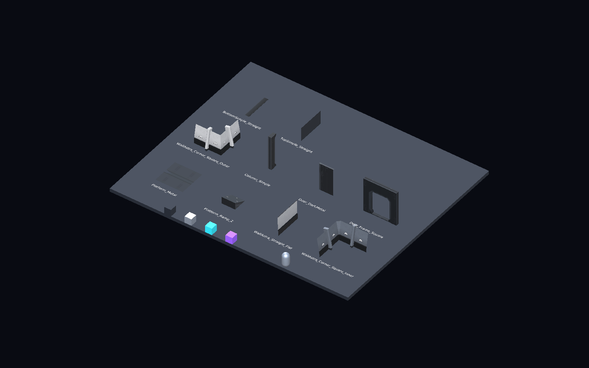

# S05-A1 — Assets visuales de Echoryx

## Alcance y auditoría inicial

Dirección confirmada para S05: **ciencia ficción temporal estilizada**, acabado 3D de detalle medio. Grafito y titanio forman la estructura; cian identifica Echo y violeta identifica Rewind. Esta etapa prepara una biblioteca y una galería, no un nivel ni una sustitución del personaje.

Antes de importar, Git estaba limpio en `2cd3002` (`feat: integrate temporal abilities and checkpoints`). `Assets/_Echoryx/Art`, Audio y Settings no tenían contenido de producción; Materials conservaba los siete materiales de las mecánicas, Scenes contenía Prototype y Laboratory, Prefabs conservaba Player y Scripts/Tests contenían S01–S04. Se respetaron esos recursos y sus `.meta`. Unity 6000.3.22f1, URP 17.3.0, Input System 1.20.1 y Cinemachine 3.1.7 permanecen fijados; el pipeline por defecto es `Assets/Settings/PC_RPAsset.asset`.

## Procedencia y licencia

- Autor: **Quaternius**. Paquete: **Modular Sci-Fi MegaKit, Standard FREE**.
- Archivo local inspeccionado: `~/Descargas/Modular SciFi MegaKit[Standard].zip`, 48.559.316 bytes. No se descargó ni compró otro paquete; se desconoce la fecha original de descarga.
- SHA-256 del ZIP: `6fae60cf5189e44dff0bd91097f094a765acc6d57d64a85a0cc0dd56e03035e3`.
- [Página oficial](https://quaternius.com/packs/modularscifimegakit.html) y [distribución oficial en itch.io](https://quaternius.itch.io/modular-sci-fi-megakit), consultadas el 2026-10-09.
- `License_Standard.txt`, conservado byte por byte junto a los modelos, declara **CC0 1.0 Universal**. Las páginas oficiales también identifican Standard como la edición gratuita bajo CC0. [Resumen oficial CC0](https://creativecommons.org/publicdomain/zero/1.0/) y [texto legal](https://creativecommons.org/publicdomain/zero/1.0/legalcode).
- CC0 permite copiar, modificar y distribuir, también para fines comerciales, sin solicitar permiso; la atribución no es un requisito de copyright. Conservamos voluntariamente la procedencia: “Modular Sci-Fi MegaKit by Quaternius — CC0 1.0”. Esto no representa aprobación de Echoryx por su autor.
- **No se utilizó Pro ni Source.** Standard no trae el proyecto URP ni los shaders personalizados/colliders optimizados de Source; los materiales de Echoryx se crearon localmente mediante Unity.

El manifiesto [provenance.json](../Assets/_Echoryx/Art/Environment/Quaternius/ModularSciFiMegaKitStandard/provenance.json) registra edición, enlaces, ruta interna del ZIP, tamaño y SHA-256 de cada archivo copiado. Los FBX y PNG originales no fueron editados.

## Subconjunto importado

Se eligieron **10 de 189 modelos únicos** de `FBX (Unity)`; no se importó la variante FBX general duplicada, OBJ/glTF, aliens, mobiliario, vistas previas ni modelos ajenos a la estructura. Son aproximadamente 6 MB de fuentes incluyendo ocho texturas y licencia.

| Categoría / ruta en Models | Uso previsto | Medidas importadas aproximadas (m) |
|---|---|---|
| `Platforms/Platform_Metal.fbx` | Suelo modular | 4 × 0 × 4 |
| `Platforms/Platform_Ramp_2.fbx` | Conectar desniveles sin un segundo paquete | 2 × 1 × 2 |
| `Walls/WallAstra_Straight_Flat.fbx` | Pared recta | 0,1 × 3 × 4 |
| `Walls/WallAstra_Corner_Square_Inner.fbx` | Esquina interior | 4,77 × 3,03 × 4,77 |
| `Walls/WallAstra_Corner_Square_Outer.fbx` | Esquina exterior | 4,44 × 3,03 × 4,44 |
| `Columns/Column_Simple.fbx` | Columna estructural | 0,51 × 5 × 0,97 |
| `Platforms/Door_DarkMetal.fbx` | Panel de puerta visual | 2,11 × 4,05 × 0,20 |
| `Platforms/Door_Frame_Square.fbx` | Marco separado del panel | 4,85 × 5,01 × 0,51 |
| `Walls/BottomSimple_Straight.fbx` | Remate inferior | 0,60 × 0,02 × 4 |
| `Walls/TopSimple_Straight.fbx` | Remate superior de pared | 0 × 2 × 4 |

Las dimensiones son bounds, **no medidas de encaje**: esquinas/columnas/marcos incluyen salientes. [Informe de Unity](visual-assets-import-report.json) conserva centros, tamaños, escala/rotación raíz, factor de unidades FBX, vértices, triángulos de todos los submeshes y materiales usados.

## Organización y materiales

```text
Assets/_Echoryx/
  Art/Environment/Quaternius/ModularSciFiMegaKitStandard/
    Models/{Platforms,Walls,Columns}/     # 10 FBX originales
    Textures/                            # 8 PNG originales
    License_Standard.txt
    provenance.json
    README.md
  Materials/Environment/                 # 9 materiales locales URP Lit
  Scenes/VisualAssetLab.unity             # Galería independiente, no gameplay
  Scripts/Game/Editor/S05VisualAssetsSetup.cs
```

Cuatro materiales básicos opacos, sin texturas obligatorias:

| Material | Color sRGB | Metallic / Smoothness | Uso |
|---|---|---|---|
| Graphite | `#252C38` | 0,45 / 0,35 | Estructura oscura |
| Titanium | `#A7B2C2` | 0,65 / 0,45 | Superficies y marcos claros |
| EchoCyan | `#29DCEB` | 0,15 / 0,40 | Señal Echo; emisión moderada |
| RewindViolet | `#995CF2` | 0,15 / 0,40 | Señal Rewind; emisión moderada |

Para mantener detalle en geometría ligera se reutilizan las UV y trim sheets del paquete: tres BaseColor, tres Normal, la variante Cables y el atlas Decals. Los cinco materiales auxiliares son `Trim01Titanium`, `Trim02Graphite`, `Trim03Titanium`, `Trim03GraphiteCables` y `Decals`. Se remapean los slots originales explícitamente en ModelImporter, sin extraer materiales Standard ni modificar los FBX. Los trims usan tintes neutros; algunos detalles/decals conservan colores del atlas original, todavía pendientes de dirección artística final.

Los ocho PNG se importan con mipmaps y límite de 2048; los Normal son NormalMap, sin sRGB ni uso de alfa. Decals conserva alfa y usa URP Lit con alpha clipping (umbral 0,35), no un shader de Unreal ni una transparencia aplicada a la estructura. Se omiten ORM: su empaquetado no coincide directamente con Metallic/Smoothness de URP Lit; esta etapa usa valores constantes. Tampoco se importan DetailMask, variantes rojo/azul, padded walls ni shaders de pago. La emisión no incorpora bloom ni efectos nuevos.

## Escala, pivotes y límites detectados

- Factor FBX de unidades 0,01, `useFileScale = true`, `globalScale = 1`, raíz a escala (1,1,1). Unity convierte centímetros a metros; no multiplicar de nuevo por 100 ni aplicar un factor arbitrario de 0,01 a las instancias.
- Suelo nominal de 4 m. La pared inferior tiene 3 m; el remate superior completa otros 2 m, coherente con columnas/marcos de unos 5 m. Usar una cuadrícula nominal de 4 m en S05-A2 y verificar cada encaje, no redondear automáticamente bounds.
- Los pivotes no están todos centrados. Pared recta desplazada a x ≈ 2,05; remate superior en x = 2, y = 4; panel de puerta con centro x ≈ 1,05. Conservar estas referencias al crear wrappers/prefabs; no sustituir pivotes nativos por el centro de bounds.
- Algunas superficies son de una cara. La galería gira la pared plana, esquina interior y remate superior para mostrarlas desde la cámara; no altera el modelo. Para habitaciones se debe orientar cada cara correctamente, sin desactivar globalmente el backface culling como parche.
- `Platform_Metal` es un plano sin grosor. **No hay colliders automáticos, Rigidbody, scripts ni animaciones en estos modelos.** S05-A2 debe separar mallas visuales de colliders simples, especialmente suelo, hueco del marco y panel de puerta. La puerta es un recurso estático, no un mecanismo nuevo.
- El remapeo corrige referencias de materiales/texturas del export original; no hacen falta rutas locales del ordenador del autor ni shaders Source. Las normales y sombreado final necesitan revisión durante el montaje próximo, con iluminación de sala.
- La apariencia de detalle medio proviene principalmente de trim sheets y normales, no de geometría densa. No se añaden efectos temporales definitivos, lightmaps ni optimizaciones de build en esta etapa.

## Uso y verificación

Menús:

1. `Echoryx/S05-A1/Prepare Visual Assets`: configura este subconjunto y materiales; crea la galería si no existe. No abre escenas de gameplay ni reemplaza una galería existente. Reejecutarlo vuelve a aplicar la configuración documentada a los nuevos assets/materiales de S05-A1.
2. `Echoryx/S05-A1/Validate Visual Assets`: comprueba los diez modelos, slots remapeados a URP Lit, ausencia de componentes de gameplay y configuración de importación; actualiza el informe.
3. `Echoryx/S05-A1/Render Visual Lab Preview`: abre solo VisualAssetLab y guarda una captura en `docs/images/s05-a1-visual-lab.png`. Requiere un dispositivo gráfico; no funciona con `-nographics`.

`RebuildLab` es una entrada explícita de CLI que reconstruye **solo VisualAssetLab**; sobrescribe cambios manuales de presentación de esa galería y no es necesaria para usar los assets. No ejecutarla sobre una galería personalizada sin conservar esos cambios.

El resultado observado y los pasos pendientes se registran en [testing](testing.md#s05-a1-importación-y-galería-visual). Esta escena no está en Build Settings y no incluye Player, Echo, Rewind, checkpoints ni navegación. Permite comprobar los recursos antes de integrarlos.



## Montaje posterior: S05-A2

Montar **una pequeña sala de referencia visual en una escena separada**, sobre cuadrícula de 4 m: suelo, tramo de pared + remate superior, esquinas, columnas y puerta con marco. Crear wrappers de prefab con raíces lógicas/pivotes consistentes y colliders simples independientes, ajustar iluminación/contraste y proporciones respecto al jugador de 2 m, y comprobar encajes/visibilidad a distancia de cámara de tercera persona. Usar cian/violeta para señalar funciones temporales, sin sustituir todavía Prototype, sus puzzles ni al protagonista. Resolver ahí los offsets del marco/panel y las caras de paredes antes de montar el nivel definitivo.

S05-A2 ya incorpora esta sala y cinco wrappers en una escena separada. Consultar [VisualReferenceRoom](visual-reference-room.md) para los encajes reales, colisiones, cámara, capturas y pendientes. La biblioteca S05-A1 permanece intacta.
